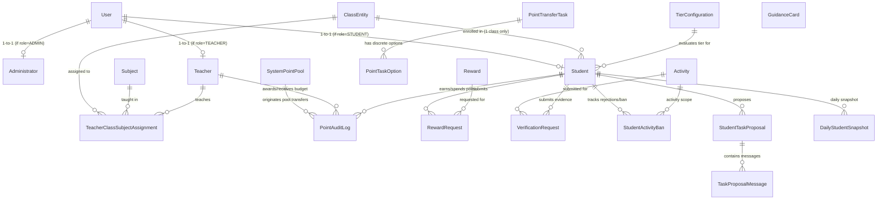
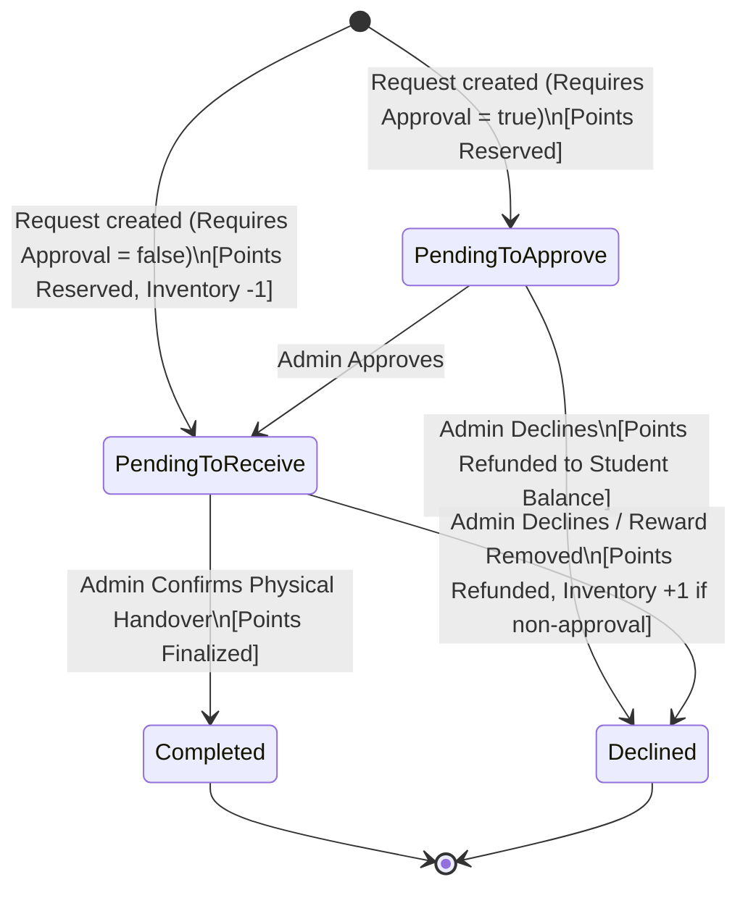
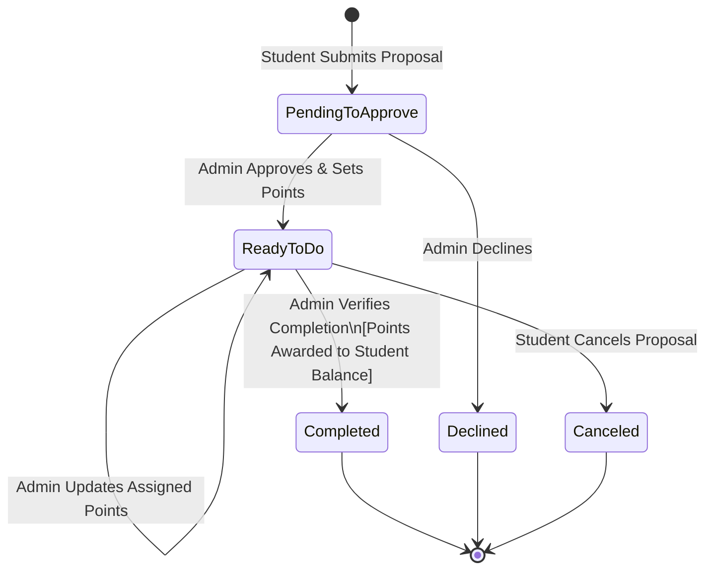
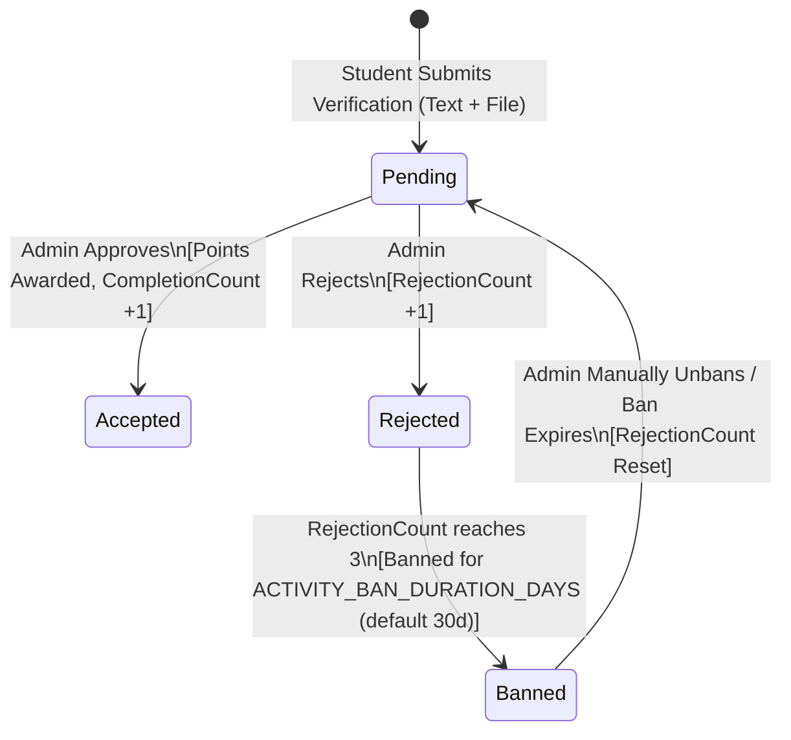

# Data Model: Student Reward System Backend

**Feature Branch**: `001-student-reward-backend`
**Date**: 2026-09-24
**Status**: Complete

---

## 1. Entity Relationship Overview

---

## 2. Core Entities & Schema Definition

### 2.1 User & Identity

#### `User`
Primary identity model supporting 10-digit national ID credentials and role segregation.

| Field | Type | Modifiers / Constraints | Description |
| :--- | :--- | :--- | :--- |
| `id` | UUID | PK, default: `gen_random_uuid()` | Unique user identifier |
| `national_id` | VARCHAR(10) | UNIQUE, NOT NULL, `CHECK (national_id ~ '^[0-9]{10}$')` | 10-digit National ID |
| `first_name` | VARCHAR(100) | NOT NULL | Given name |
| `last_name` | VARCHAR(100) | NOT NULL | Family name |
| `username` | VARCHAR(50) | UNIQUE, NOT NULL | Unique username |
| `password_hash` | VARCHAR(255) | NOT NULL | Argon2id password hash |
| `role` | ENUM | NOT NULL: `ADMIN`, `TEACHER`, `STUDENT` | System authorization role |
| `account_state` | ENUM | NOT NULL: `ACTIVE`, `INACTIVE`, `DEACTIVATED`, `DEPARTED` | Lifecycle account state |
| `created_at` | TIMESTAMPTZ | NOT NULL, default: `now()` | Record creation timestamp |
| `updated_at` | TIMESTAMPTZ | NOT NULL, default: `now()` | Record modification timestamp |

#### `TeacherProfile`
Specific profile for teacher accounts tracking point allocation budget.

| Field | Type | Modifiers / Constraints | Description |
| :--- | :--- | :--- | :--- |
| `id` | UUID | PK, FK $\rightarrow$ `User.id` ON DELETE CASCADE | Profile ID matching User ID |
| `point_balance` | INTEGER | NOT NULL, default: 0, `CHECK (point_balance >= 0)` | Available point budget to award |

#### `StudentProfile`
Specific profile for student accounts tracking current balances, tier, and ranking stats.

| Field | Type | Modifiers / Constraints | Description |
| :--- | :--- | :--- | :--- |
| `id` | UUID | PK, FK $\rightarrow$ `User.id` ON DELETE CASCADE | Profile ID matching User ID |
| `class_id` | UUID | FK $\rightarrow$ `Class.id` ON DELETE SET NULL, NULLABLE | Exactly one assigned class |
| `current_balance`| INTEGER | NOT NULL, default: 0, `CHECK (current_balance >= 0)` | Spendable reward points |
| `reserved_balance`| INTEGER | NOT NULL, default: 0, `CHECK (reserved_balance >= 0)`| Points reserved for pending reward requests |
| `highest_balance`| INTEGER | NOT NULL, default: 0, `CHECK (highest_balance >= 0)` | All-time highest current point balance |
| `current_tier_id` | UUID | FK $\rightarrow$ `TierConfiguration.id`, NULLABLE | Current evaluated tier |

---

### 2.2 Academic Structure

#### `Class`
| Field | Type | Modifiers / Constraints | Description |
| :--- | :--- | :--- | :--- |
| `id` | UUID | PK, default: `gen_random_uuid()` | Unique class ID |
| `name` | VARCHAR(100) | NOT NULL, UNIQUE | Class name or label (e.g. `7A`, `Grade 10B`) |
| `grade_level` | VARCHAR(50) | NULLABLE | Optional grade level metadata |
| `description` | TEXT | NULLABLE | Optional class description |
| `is_active` | BOOLEAN | NOT NULL, default: `true` | Class status |
| `created_at` | TIMESTAMPTZ | NOT NULL, default: `now()` | Creation timestamp |
| `updated_at` | TIMESTAMPTZ | NOT NULL, default: `now()` | Update timestamp |

#### `Subject`
| Field | Type | Modifiers / Constraints | Description |
| :--- | :--- | :--- | :--- |
| `id` | UUID | PK, default: `gen_random_uuid()` | Unique subject ID |
| `name` | VARCHAR(100) | NOT NULL, UNIQUE | Subject name (e.g. `Mathematics`, `Science`) |
| `description` | TEXT | NULLABLE | Optional subject description |
| `created_at` | TIMESTAMPTZ | NOT NULL, default: `now()` | Creation timestamp |
| `updated_at` | TIMESTAMPTZ | NOT NULL, default: `now()` | Update timestamp |

#### `TeacherClassSubjectAssignment`
| Field | Type | Modifiers / Constraints | Description |
| :--- | :--- | :--- | :--- |
| `id` | UUID | PK, default: `gen_random_uuid()` | Assignment ID |
| `teacher_id` | UUID | FK $\rightarrow$ `User.id` ON DELETE CASCADE, NOT NULL | Assigned teacher |
| `class_id` | UUID | FK $\rightarrow$ `Class.id` ON DELETE CASCADE, NOT NULL | Assigned class |
| `subject_id` | UUID | FK $\rightarrow$ `Subject.id` ON DELETE CASCADE, NOT NULL | Assigned subject |
| `status` | ENUM | NOT NULL: `ACTIVE`, `REMOVED` | Assignment state |
| `created_at` | TIMESTAMPTZ | NOT NULL, default: `now()` | Creation timestamp |
| `updated_at` | TIMESTAMPTZ | NOT NULL, default: `now()` | Update timestamp |
| *Constraint* | UNIQUE (`teacher_id`, `class_id`, `subject_id`) | Ensures unique active triplet |

---

### 2.3 Point Economy & Auditing

#### `SystemPointPool`
Singleton balance tracking the system-wide pool of points available for admin distribution.

| Field | Type | Modifiers / Constraints | Description |
| :--- | :--- | :--- | :--- |
| `id` | UUID | PK, default: `gen_random_uuid()` | Singleton pool record ID |
| `balance` | INTEGER | NOT NULL, default: 0, `CHECK (balance >= 0)` | Total available system points |
| `updated_at` | TIMESTAMPTZ | NOT NULL, default: `now()` | Last update timestamp |

#### `PointTransferTask`
Predefined task types defined by administrators for teacher awards.

| Field | Type | Modifiers / Constraints | Description |
| :--- | :--- | :--- | :--- |
| `id` | UUID | PK, default: `gen_random_uuid()` | Task ID |
| `name` | VARCHAR(150) | NOT NULL, UNIQUE | Task name (e.g., `Doing Homework`) |
| `description` | TEXT | NULLABLE | Optional description |
| `is_active` | BOOLEAN | NOT NULL, default: `true` | Active status |
| `created_at` | TIMESTAMPTZ | NOT NULL, default: `now()` | Creation timestamp |

#### `PointTaskOption`
Discrete positive point options belonging to a `PointTransferTask`.

| Field | Type | Modifiers / Constraints | Description |
| :--- | :--- | :--- | :--- |
| `id` | UUID | PK, default: `gen_random_uuid()` | Option ID |
| `task_id` | UUID | FK $\rightarrow$ `PointTransferTask.id` ON DELETE CASCADE, NOT NULL | Parent task ID |
| `points` | INTEGER | NOT NULL, `CHECK (points > 0)` | Discrete positive point value |
| `label` | VARCHAR(100) | NULLABLE | Optional label (e.g. `Excellent Effort`) |

#### `PointAuditLog`
Append-only immutable audit trail for every point event in the system.

| Field | Type | Modifiers / Constraints | Description |
| :--- | :--- | :--- | :--- |
| `id` | UUID | PK, default: `gen_random_uuid()` | Unique audit log ID |
| `correlation_id`| VARCHAR(64) | NOT NULL | Request correlation identifier |
| `actor_id` | UUID | FK $\rightarrow$ `User.id` ON DELETE SET NULL, NOT NULL | User initiating the action |
| `actor_role` | ENUM | NOT NULL: `ADMIN`, `TEACHER`, `STUDENT`, `SYSTEM` | Role at action time |
| `source_type` | ENUM | NOT NULL: `SYSTEM_POOL`, `TEACHER`, `STUDENT_CURRENT`, `STUDENT_RESERVED` | Source balance entity |
| `source_id` | UUID | NULLABLE | ID of source user/entity |
| `recipient_type`| ENUM | NOT NULL: `TEACHER`, `STUDENT_CURRENT`, `STUDENT_RESERVED`, `SYSTEM_POOL`, `NONE` | Destination balance entity |
| `recipient_id` | UUID | NULLABLE | ID of recipient user/entity |
| `amount` | INTEGER | NOT NULL, `CHECK (amount > 0)` | Points transferred/adjusted |
| `action_type` | ENUM | NOT NULL: `POOL_FUND_TEACHER`, `TEACHER_AWARD_STUDENT`, `ADMIN_ADJUST_STUDENT`, `REWARD_RESERVE_POINTS`, `REWARD_DECLINE_RETURN`, `REWARD_REMOVE_RETURN`, `REWARD_RECEIVE_COMPLETE`, `CHALLENGE_AWARD_STUDENT`, `PROPOSAL_AWARD_STUDENT` | Action classification |
| `task_or_reason`| TEXT | NOT NULL | Reason description or task name/option |
| `related_entity_type` | VARCHAR(50) | NULLABLE | E.g. `Class`, `Subject`, `RewardRequest`, `Activity`, `Proposal` |
| `related_entity_id` | UUID | NULLABLE | ID of related entity |
| `resulting_source_balance` | INTEGER | NULLABLE | Resulting balance of source |
| `resulting_recipient_balance` | INTEGER | NULLABLE | Resulting balance of recipient |
| `created_at` | TIMESTAMPTZ | NOT NULL, default: `now()` | Immutable creation timestamp |

---

### 2.4 Reward Catalog & Redemptions

#### `Reward`
| Field | Type | Modifiers / Constraints | Description |
| :--- | :--- | :--- | :--- |
| `id` | UUID | PK, default: `gen_random_uuid()` | Reward ID |
| `name` | VARCHAR(150) | NOT NULL | Reward name |
| `description` | TEXT | NOT NULL | Reward description |
| `image_url` | VARCHAR(500) | NULLABLE | Optional image media reference |
| `point_price` | INTEGER | NOT NULL, `CHECK (point_price > 0)` | Immutable point price |
| `requires_approval` | BOOLEAN | NOT NULL | Approval required flag |
| `inventory_quantity`| INTEGER | NULLABLE, `CHECK (inventory_quantity >= 0)` | Finite for non-approval; NULL for approval-required |
| `status` | ENUM | NOT NULL, default: `ACTIVE`: `ACTIVE`, `REMOVED` | Catalog status |
| `created_at` | TIMESTAMPTZ | NOT NULL, default: `now()` | Creation timestamp |
| `updated_at` | TIMESTAMPTZ | NOT NULL, default: `now()` | Update timestamp |

#### `RewardRequest`
| Field | Type | Modifiers / Constraints | Description |
| :--- | :--- | :--- | :--- |
| `id` | UUID | PK, default: `gen_random_uuid()` | Request ID |
| `student_id` | UUID | FK $\rightarrow$ `User.id` ON DELETE CASCADE, NOT NULL | Requesting student |
| `reward_id` | UUID | FK $\rightarrow$ `Reward.id` ON DELETE RESTRICT, NOT NULL | Target reward |
| `price_at_request` | INTEGER | NOT NULL | Snapshot of price at request time |
| `requires_approval` | BOOLEAN | NOT NULL | Snapshot of approval requirement |
| `status` | ENUM | NOT NULL: `PENDING_TO_APPROVE`, `PENDING_TO_RECEIVE`, `COMPLETED`, `DECLINED` | Request status |
| `reserved_amount` | INTEGER | NOT NULL, default: 0 | Points currently held in reservation |
| `decline_reason` | TEXT | NULLABLE | Admin explanation if declined |
| `reviewed_by_admin_id` | UUID | FK $\rightarrow$ `User.id` ON DELETE SET NULL, NULLABLE | Reviewing administrator |
| `reviewed_at` | TIMESTAMPTZ | NULLABLE | Review timestamp |
| `completed_at` | TIMESTAMPTZ | NULLABLE | Physical handover timestamp |
| `created_at` | TIMESTAMPTZ | NOT NULL, default: `now()` | Request creation timestamp |
| `updated_at` | TIMESTAMPTZ | NOT NULL, default: `now()` | Request update timestamp |

**Business constraint (FR-096):** A student may have at most one reward request in a pending status (`PENDING_TO_APPROVE` or `PENDING_TO_RECEIVE`) per reward. This is enforced at the application layer before request creation.

---

### 2.5 Challenges, Missions & Verification

#### `Activity` (Challenge / Mission)
| Field | Type | Modifiers / Constraints | Description |
| :--- | :--- | :--- | :--- |
| `id` | UUID | PK, default: `gen_random_uuid()` | Activity ID |
| `type` | ENUM | NOT NULL: `CHALLENGE`, `MISSION` | Activity category |
| `title` | VARCHAR(150) | NOT NULL | Activity title |
| `description` | TEXT | NOT NULL | Action/description required |
| `point_value` | INTEGER | NOT NULL, `CHECK (point_value > 0)` | Immutable fixed point reward |
| `completion_limit`| INTEGER | NOT NULL, `CHECK (completion_limit > 0)` | Max completions allowed per student |
| `status` | ENUM | NOT NULL, default: `ACTIVE`: `ACTIVE`, `INACTIVE`, `REMOVED` | Activity status |
| `created_at` | TIMESTAMPTZ | NOT NULL, default: `now()` | Creation timestamp |
| `updated_at` | TIMESTAMPTZ | NOT NULL, default: `now()` | Update timestamp |

#### `VerificationRequest`
| Field | Type | Modifiers / Constraints | Description |
| :--- | :--- | :--- | :--- |
| `id` | UUID | PK, default: `gen_random_uuid()` | Request ID |
| `student_id` | UUID | FK $\rightarrow$ `User.id` ON DELETE CASCADE, NOT NULL | Submitting student |
| `activity_id` | UUID | FK $\rightarrow$ `Activity.id` ON DELETE RESTRICT, NOT NULL | Target activity |
| `text_description` | TEXT | NOT NULL | Student's submission explanation |
| `file_attachment_url`| VARCHAR(500)| NULLABLE | Evidence image/document URL |
| `status` | ENUM | NOT NULL, default: `PENDING`: `PENDING`, `ACCEPTED`, `REJECTED` | Verification outcome |
| `rejection_reason` | TEXT | NULLABLE | Admin rejection explanation |
| `reviewed_by_admin_id`| UUID | FK $\rightarrow$ `User.id` ON DELETE SET NULL, NULLABLE | Reviewing administrator |
| `reviewed_at` | TIMESTAMPTZ | NULLABLE | Review timestamp |
| `created_at` | TIMESTAMPTZ | NOT NULL, default: `now()` | Submission timestamp |

#### `StudentActivityProgress`
Tracks completion counts, rejection counts, and temporary submission bans per student per activity.

| Field | Type | Modifiers / Constraints | Description |
| :--- | :--- | :--- | :--- |
| `id` | UUID | PK, default: `gen_random_uuid()` | Progress record ID |
| `student_id` | UUID | FK $\rightarrow$ `User.id` ON DELETE CASCADE, NOT NULL | Student ID |
| `activity_id` | UUID | FK $\rightarrow$ `Activity.id` ON DELETE CASCADE, NOT NULL | Activity ID |
| `completion_count` | INTEGER | NOT NULL, default: 0 | Number of accepted completions |
| `rejection_count` | INTEGER | NOT NULL, default: 0 | Consecutive/total rejections count |
| `banned_until` | TIMESTAMPTZ | NULLABLE | Dynamic ban expiration timestamp (default: 30 days via `ACTIVITY_BAN_DURATION_DAYS`) if 3 rejections reached |
| `created_at` | TIMESTAMPTZ | NOT NULL, default: `now()` | Record creation |
| `updated_at` | TIMESTAMPTZ | NOT NULL, default: `now()` | Record update |
| *Constraint* | UNIQUE (`student_id`, `activity_id`) | Exactly one tracking row per student/activity |

---

### 2.6 Student Task Proposals & In-Request Messaging

#### `StudentTaskProposal`
| Field | Type | Modifiers / Constraints | Description |
| :--- | :--- | :--- | :--- |
| `id` | UUID | PK, default: `gen_random_uuid()` | Proposal ID |
| `student_id` | UUID | FK $\rightarrow$ `User.id` ON DELETE CASCADE, NOT NULL | Submitting student |
| `description` | TEXT | NOT NULL | Proposed task description |
| `status` | ENUM | NOT NULL, default: `PENDING_TO_APPROVE`: `PENDING_TO_APPROVE`, `READY_TO_DO`, `COMPLETED`, `DECLINED`, `CANCELED` | Proposal lifecycle state |
| `assigned_point_value` | INTEGER | NULLABLE, `CHECK (assigned_point_value > 0)` | Set on approval; editable while `READY_TO_DO` |
| `decline_reason` | TEXT | NULLABLE | Reason provided by administrator upon declining |
| `reviewed_by_admin_id`| UUID | FK $\rightarrow$ `User.id` ON DELETE SET NULL, NULLABLE | Reviewing administrator |
| `approved_at` | TIMESTAMPTZ | NULLABLE | Approval timestamp |
| `completed_at` | TIMESTAMPTZ | NULLABLE | Completion timestamp |
| `created_at` | TIMESTAMPTZ | NOT NULL, default: `now()` | Submission timestamp |
| `updated_at` | TIMESTAMPTZ | NOT NULL, default: `now()` | Modification timestamp |

#### `TaskProposalMessage`
In-request messaging thread isolated between student and administrators.

| Field | Type | Modifiers / Constraints | Description |
| :--- | :--- | :--- | :--- |
| `id` | UUID | PK, default: `gen_random_uuid()` | Message ID |
| `proposal_id` | UUID | FK $\rightarrow$ `StudentTaskProposal.id` ON DELETE CASCADE, NOT NULL | Parent proposal |
| `sender_id` | UUID | FK $\rightarrow$ `User.id` ON DELETE SET NULL, NOT NULL | Sending user |
| `sender_role` | ENUM | NOT NULL: `STUDENT`, `ADMIN` | Sender role (teachers strictly excluded) |
| `message` | TEXT | NOT NULL | Message body |
| `created_at` | TIMESTAMPTZ | NOT NULL, default: `now()` | Message sent timestamp |

---

### 2.7 Tier Configurations, Daily Snapshots & Guidance Cards

#### `TierConfiguration`
Exactly 5 administrator-managed student tier levels.

| Field | Type | Modifiers / Constraints | Description |
| :--- | :--- | :--- | :--- |
| `id` | UUID | PK, default: `gen_random_uuid()` | Tier ID |
| `tier_number` | INTEGER | NOT NULL, UNIQUE, `CHECK (tier_number BETWEEN 1 AND 5)` | 1 (lowest) to 5 (highest) |
| `name` | VARCHAR(100) | NOT NULL | Tier display name (e.g. `Bronze`, `Silver`) |
| `min_points_threshold` | INTEGER | NOT NULL, `CHECK (min_points_threshold >= 0)` | Minimum points to enter tier |
| `created_at` | TIMESTAMPTZ | NOT NULL, default: `now()` | Creation timestamp |
| `updated_at` | TIMESTAMPTZ | NOT NULL, default: `now()` | Update timestamp |

#### `DailyStudentSnapshot`
Midnight snapshot capturing point balance, school-wide rank, and class rank for weekly charting and rank trend analysis.

| Field | Type | Modifiers / Constraints | Description |
| :--- | :--- | :--- | :--- |
| `id` | UUID | PK, default: `gen_random_uuid()` | Snapshot record ID |
| `student_id` | UUID | FK $\rightarrow$ `User.id` ON DELETE CASCADE, NOT NULL | Student ID |
| `balance` | INTEGER | NOT NULL | Recorded current balance |
| `school_rank` | INTEGER | NOT NULL | School-wide standard competition rank at snapshot time |
| `class_rank` | INTEGER | NULLABLE | Class-level standard competition rank at snapshot time (null if student has no class) |
| `snapshot_date` | DATE | NOT NULL | Date of snapshot (YYYY-MM-DD) |
| `created_at` | TIMESTAMPTZ | NOT NULL, default: `now()` | Snapshot creation timestamp |
| *Constraint* | UNIQUE (`student_id`, `snapshot_date`) | Exactly one snapshot per student per day |

#### `GuidanceCard`
Informational display-only cards for students.

| Field | Type | Modifiers / Constraints | Description |
| :--- | :--- | :--- | :--- |
| `id` | UUID | PK, default: `gen_random_uuid()` | Guidance card ID |
| `title` | VARCHAR(150) | NOT NULL | Title |
| `description` | TEXT | NOT NULL | Description of earning opportunity |
| `logo_key` | VARCHAR(100) | NOT NULL | Predefined logo identifier |
| `point_range_label` | VARCHAR(100) | NOT NULL | Suggested points or range (e.g. `10 to 20 pts`) |
| `status` | ENUM | NOT NULL, default: `ACTIVE`: `ACTIVE`, `REMOVED` | Card status |
| `created_at` | TIMESTAMPTZ | NOT NULL, default: `now()` | Creation timestamp |
| `updated_at` | TIMESTAMPTZ | NOT NULL, default: `now()` | Update timestamp |

---

## 3. State Machines & Lifecycle Transitions

### 3.1 Reward Request Lifecycle

### 3.2 Student Task Proposal Lifecycle

### 3.3 Activity Verification Lifecycle & Abuse Protection

