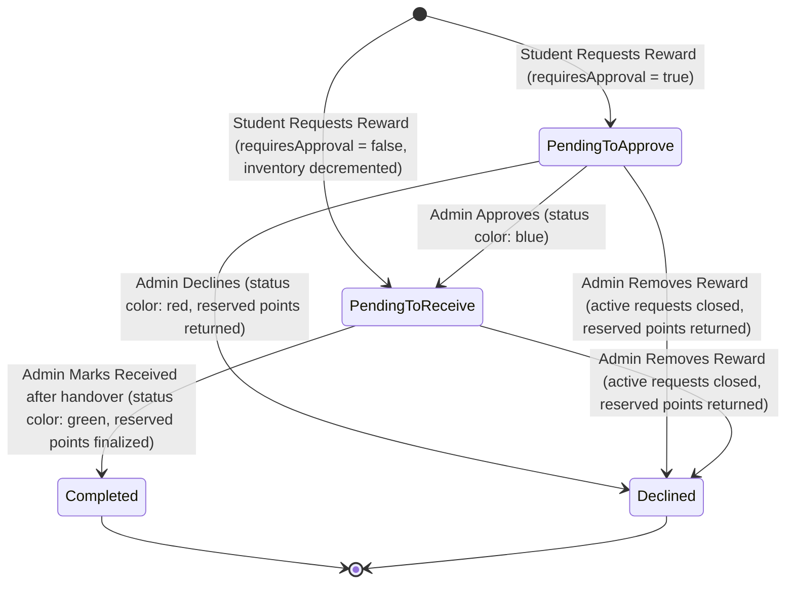
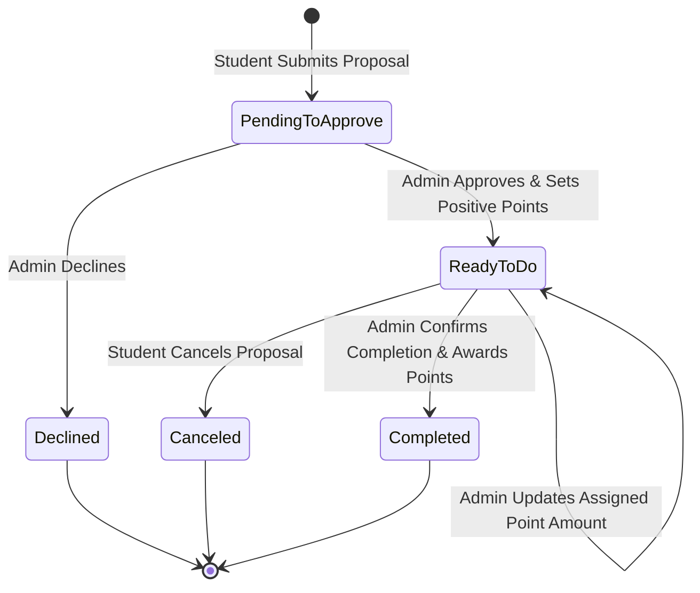
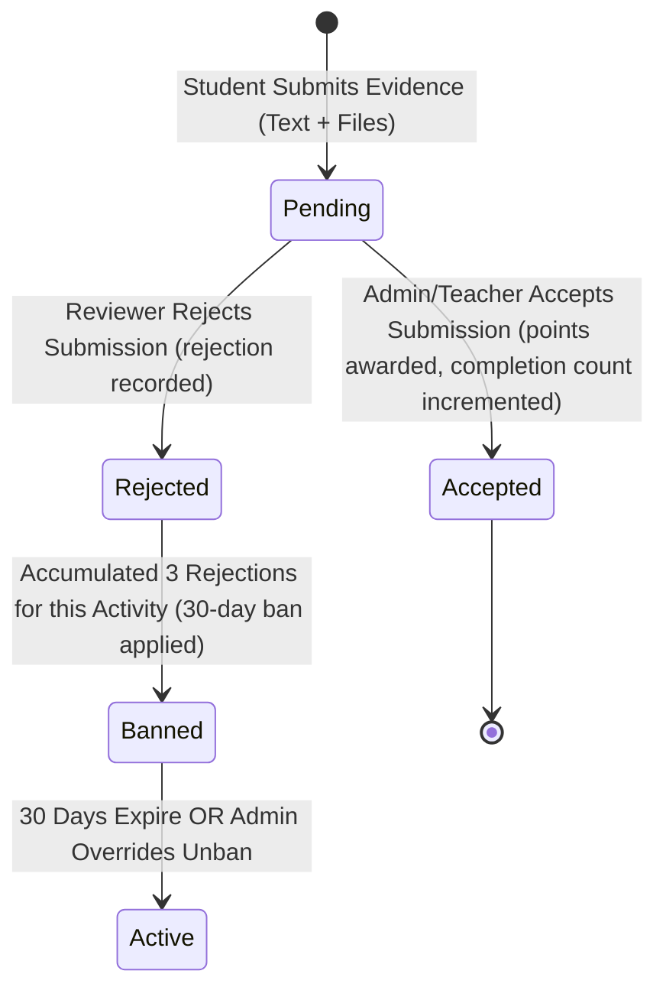

# Data Model Specification: Student Reward System Backend

**Feature Branch**: `001-student-reward-backend`  
**Date**: 2026-09-19  
**Status**: Completed  

This document details the domain entities, attribute specifications, relational associations, validation rules, and state machine lifecycles for the Student Reward System Backend, satisfying the requirements from `spec.md` and `docs/requirements/data-requirements.md`.

---

## 1. Domain Entities & Schemas

### 1.1 Account & User Entities

#### `Administrator`
System managers with full administrative control across accounts, academic configurations, point pool, rewards, guidance, challenges, and unban overrides.

| Field | Type | Nullable | Constraints & Defaults | Description |
|-------|------|----------|------------------------|-------------|
| `id` | UUID | No | Primary Key | Unique system identifier |
| `nationalId` | String(10) | No | Unique, Regex `^\d{10}$` | 10-digit primary identity |
| `username` | String(50) | No | Unique | Login username |
| `firstName` | String(50) | No | Non-empty | User's first name |
| `lastName` | String(50) | No | Non-empty | User's last name |
| `passwordHash` | String | No | Argon2id hash | Opaque hashed credential |
| `accountState` | Enum | No | `Active`, `Inactive` (Default: `Active`) | Operational status |
| `createdAt` | Timestamp | No | Default: `now()` | Record creation timestamp |
| `updatedAt` | Timestamp | No | Auto-update | Last modification timestamp |

#### `Teacher`
Subject educators assigned to classes who award points from their allocated point budget.

| Field | Type | Nullable | Constraints & Defaults | Description |
|-------|------|----------|------------------------|-------------|
| `id` | UUID | No | Primary Key | Unique system identifier |
| `nationalId` | String(10) | No | Unique, Regex `^\d{10}$` | 10-digit primary identity |
| `username` | String(50) | No | Unique | Login username |
| `firstName` | String(50) | No | Non-empty | Teacher's first name |
| `lastName` | String(50) | No | Non-empty | Teacher's last name |
| `passwordHash` | String | No | Argon2id hash | Opaque hashed credential |
| `accountState` | Enum | No | `Active`, `Deactivated`, `Departed` (Default: `Active`) | Operational status |
| `pointBalance` | Integer | No | Default: `0`, Check `>= 0` | Available award budget |
| `createdAt` | Timestamp | No | Default: `now()` | Record creation timestamp |
| `updatedAt` | Timestamp | No | Auto-update | Last modification timestamp |

#### `Student`
Learners who earn points, redeem catalog rewards, submit activity verifications, and propose tasks.

| Field | Type | Nullable | Constraints & Defaults | Description |
|-------|------|----------|------------------------|-------------|
| `id` | UUID | No | Primary Key | Unique system identifier |
| `nationalId` | String(10) | No | Unique, Regex `^\d{10}$` | 10-digit primary identity |
| `username` | String(50) | No | Unique | Login username |
| `firstName` | String(50) | No | Non-empty | Student's first name |
| `lastName` | String(50) | No | Non-empty | Student's last name |
| `passwordHash` | String | No | Argon2id hash | Opaque hashed credential |
| `accountState` | Enum | No | `Active`, `Inactive`, `Deactivated`, `Departed` (Default: `Active`) | Operational status |
| `currentPoints` | Integer | No | Default: `0`, Check `>= 0` | Current spendable points |
| `reservedPoints` | Integer | No | Default: `0`, Check `>= 0` | Points locked in active reward requests |
| `highestBalance` | Integer | No | Default: `0`, Check `>= 0` | Historical all-time high balance |
| `classId` | UUID | Yes | Foreign Key -> `Class.id` | Single assigned class (FR-008) |
| `currentTierId` | UUID | Yes | Foreign Key -> `StudentTier.id` | Dynamic tier membership |
| `createdAt` | Timestamp | No | Default: `now()` | Record creation timestamp |
| `updatedAt` | Timestamp | No | Auto-update | Last modification timestamp |

---

### 1.2 Academic Structure Entities

#### `Class`
Academic cohort grouping students for attendance, teacher eligibility, and class-level rankings.

| Field | Type | Nullable | Constraints & Defaults | Description |
|-------|------|----------|------------------------|-------------|
| `id` | UUID | No | Primary Key | Unique class identifier |
| `name` | String(50) | No | Unique, Non-empty (e.g. "7A") | Class label or identifier |
| `gradeLevel` | String(20) | Yes | Optional grade descriptor | Grade level (e.g. "Grade 7") |
| `description` | String(255)| Yes | Optional notes | Additional class details |
| `status` | Enum | No | `Active`, `Inactive` (Default: `Active`) | Operational status |
| `createdAt` | Timestamp | No | Default: `now()` | Record creation timestamp |
| `updatedAt` | Timestamp | No | Auto-update | Last modification timestamp |

#### `Subject`
Academic discipline taught within one or more classes.

| Field | Type | Nullable | Constraints & Defaults | Description |
|-------|------|----------|------------------------|-------------|
| `id` | UUID | No | Primary Key | Unique subject identifier |
| `name` | String(50) | No | Unique, Non-empty (e.g. "Math") | Subject name |
| `description` | String(255)| Yes | Optional notes | Subject overview |
| `createdAt` | Timestamp | No | Default: `now()` | Record creation timestamp |
| `updatedAt` | Timestamp | No | Auto-update | Last modification timestamp |

#### `TeacherClassSubject`
Explicit authorization link establishing which subjects a teacher instructs in each class.

| Field | Type | Nullable | Constraints & Defaults | Description |
|-------|------|----------|------------------------|-------------|
| `id` | UUID | No | Primary Key | Assignment record identifier |
| `teacherId` | UUID | No | Foreign Key -> `Teacher.id` | Assigned educator |
| `classId` | UUID | No | Foreign Key -> `Class.id` | Target class |
| `subjectId` | UUID | No | Foreign Key -> `Subject.id` | Instructed subject |
| `assignmentState` | Enum | No | `Active`, `Removed` (Default: `Active`) | Status of the assignment |
| `createdAt` | Timestamp | No | Default: `now()` | Record creation timestamp |
| `updatedAt` | Timestamp | No | Auto-update | Last modification timestamp |

*Constraint*: Unique compound index on `(teacherId, classId, subjectId)`.

---

### 1.3 Point Economy & Task Entities

#### `SystemPointPool`
Singleton administrative point repository for allocating budgets to teachers.

| Field | Type | Nullable | Constraints & Defaults | Description |
|-------|------|----------|------------------------|-------------|
| `id` | UUID | No | Primary Key (Single row) | Master pool identifier |
| `totalAllocated` | Integer | No | Check `>= 0` | Total points minted into system |
| `availableBalance` | Integer | No | Check `>= 0` | Spendable pool points |
| `updatedAt` | Timestamp | No | Auto-update | Last modification timestamp |

#### `PointTransferTask`
Administrator-defined behavioral task categories used by teachers to award points.

| Field | Type | Nullable | Constraints & Defaults | Description |
|-------|------|----------|------------------------|-------------|
| `id` | UUID | No | Primary Key | Unique task category identifier |
| `name` | String(100)| No | Unique, Non-empty (e.g. "Doing Homework") | Task title |
| `description` | Text | Yes | Optional guidelines | Context for teachers and students |
| `status` | Enum | No | `Active`, `Inactive` (Default: `Active`) | Usable for awards |
| `createdAt` | Timestamp | No | Default: `now()` | Record creation timestamp |
| `updatedAt` | Timestamp | No | Auto-update | Last modification timestamp |

#### `PointTransferTaskOption`
Predefined discrete point award values associated with a task.

| Field | Type | Nullable | Constraints & Defaults | Description |
|-------|------|----------|------------------------|-------------|
| `id` | UUID | No | Primary Key | Unique option identifier |
| `taskId` | UUID | No | Foreign Key -> `PointTransferTask.id` | Parent task reference |
| `pointAmount` | Integer | No | Check `> 0` | Fixed positive award amount |
| `createdAt` | Timestamp | No | Default: `now()` | Record creation timestamp |

*Constraint*: Unique compound index on `(taskId, pointAmount)`.

---

### 1.4 Reward Catalog & Redemption Entities

#### `Reward`
Catalog goods, privileges, or vouchers redeemable with student points.

| Field | Type | Nullable | Constraints & Defaults | Description |
|-------|------|----------|------------------------|-------------|
| `id` | UUID | No | Primary Key | Unique reward identifier |
| `name` | String(100)| No | Non-empty | Item name |
| `description` | Text | No | Non-empty | Detailed description |
| `imageRef` | String(255)| Yes | URL or file storage path | Item visual asset |
| `pointPrice` | Integer | No | Check `> 0`, Immutable | Cost in student points |
| `requiresApproval` | Boolean | No | Default: `false` | Whether review is required |
| `inventory` | Integer | Yes | Check `>= 0` | Stock (NULL if `requiresApproval = true`) |
| `status` | Enum | No | `Active`, `Removed` (Default: `Active`) | Catalog status |
| `createdAt` | Timestamp | No | Default: `now()` | Record creation timestamp |
| `updatedAt` | Timestamp | No | Auto-update | Last modification timestamp |

#### `RewardRequest`
Lifecycle record tracking student redemption requests.

| Field | Type | Nullable | Constraints & Defaults | Description |
|-------|------|----------|------------------------|-------------|
| `id` | UUID | No | Primary Key | Unique redemption identifier |
| `studentId` | UUID | No | Foreign Key -> `Student.id` | Requesting student |
| `rewardId` | UUID | No | Foreign Key -> `Reward.id` | Redeemed reward |
| `requiresApprovalSnapshot` | Boolean | No | Snapshot at request | Captured approval requirement |
| `pointPriceSnapshot` | Integer | No | Check `> 0` | Captured price at request |
| `reservedPoints` | Integer | No | Check `>= 0` | Points currently locked |
| `status` | Enum | No | `Pending to Approve`, `Pending to Receive`, `Completed`, `Declined` | Current lifecycle state |
| `reviewerId` | UUID | Yes | Foreign Key -> `Administrator.id` | Admin who reviewed/handled |
| `reviewedAt` | Timestamp | Yes | Review timestamp | Time of approve/decline |
| `receivedAt` | Timestamp | Yes | Handover timestamp | Time marked as completed |
| `createdAt` | Timestamp | No | Default: `now()` | Request submission time |
| `updatedAt` | Timestamp | No | Auto-update | Last status change time |

---

### 1.5 Challenges, Missions & Abuse Prevention Entities

#### `ChallengeMission`
Structured activities incentivizing student achievements with fixed point awards.

| Field | Type | Nullable | Constraints & Defaults | Description |
|-------|------|----------|------------------------|-------------|
| `id` | UUID | No | Primary Key | Unique activity identifier |
| `type` | Enum | No | `Challenge`, `Mission` | Activity category |
| `name` | String(100)| No | Non-empty | Activity title |
| `description` | Text | No | Non-empty | Required action details |
| `pointValue` | Integer | No | Check `> 0`, Immutable | Fixed award on completion |
| `completionLimit` | Integer | No | Check `> 0` | Max completions allowed per student |
| `status` | Enum | No | `Active`, `Inactive`, `Removed` | Activity availability status |
| `createdAt` | Timestamp | No | Default: `now()` | Record creation timestamp |
| `updatedAt` | Timestamp | No | Auto-update | Last modification timestamp |

#### `ActivityVerificationRequest`
Student proof submissions requesting completion verification.

| Field | Type | Nullable | Constraints & Defaults | Description |
|-------|------|----------|------------------------|-------------|
| `id` | UUID | No | Primary Key | Unique verification request ID |
| `studentId` | UUID | No | Foreign Key -> `Student.id` | Submitting student |
| `activityId` | UUID | No | Foreign Key -> `ChallengeMission.id` | Target activity |
| `evidenceDescription` | Text | No | Non-empty | Student narrative proof |
| `status` | Enum | No | `Pending`, `Accepted`, `Rejected` (Default: `Pending`) | Review outcome |
| `reviewerId` | UUID | Yes | Foreign Key -> `Administrator.id` / `Teacher.id` | Reviewing actor |
| `reviewNotes` | Text | Yes | Optional review feedback | Reason for accept/reject |
| `reviewedAt` | Timestamp | Yes | Review timestamp | Time decision was rendered |
| `createdAt` | Timestamp | No | Default: `now()` | Submission timestamp |
| `updatedAt` | Timestamp | No | Auto-update | Status update timestamp |

#### `VerificationAttachment`
Direct file or image evidence uploaded to support an activity verification request.

| Field | Type | Nullable | Constraints & Defaults | Description |
|-------|------|----------|------------------------|-------------|
| `id` | UUID | No | Primary Key | Attachment identifier |
| `verificationRequestId` | UUID | No | Foreign Key -> `ActivityVerificationRequest.id` | Associated verification request |
| `originalFilename` | String(255)| No | Non-empty | Original user upload name |
| `storedPath` | String(500)| No | Unique | Local filesystem storage path |
| `mimeType` | String(100)| No | MIME type allowlist | e.g. `image/jpeg`, `image/png`, `application/pdf` |
| `sizeBytes` | Integer | No | Check `> 0` and `<= 10485760` | File size (max 10MB) |
| `createdAt` | Timestamp | No | Default: `now()` | Upload timestamp |

#### `StudentActivityBan`
Abuse prevention record triggered on 3 rejections for a specific student and activity.

| Field | Type | Nullable | Constraints & Defaults | Description |
|-------|------|----------|------------------------|-------------|
| `id` | UUID | No | Primary Key | Ban record identifier |
| `studentId` | UUID | No | Foreign Key -> `Student.id` | Penalized student |
| `activityId` | UUID | No | Foreign Key -> `ChallengeMission.id` | Target activity |
| `bannedAt` | Timestamp | No | Default: `now()` | Time ban was initiated |
| `bannedUntil` | Timestamp | No | Default: `bannedAt + 30 days` | Ban expiration boundary |
| `unbannedAt` | Timestamp | Yes | Admin override timestamp | Time cleared early by admin |
| `unbannedById` | UUID | Yes | Foreign Key -> `Administrator.id` | Overriding administrator |
| `reason` | String(255)| No | e.g. "Automated 3-rejection abuse ban" | Ban justification |
| `createdAt` | Timestamp | No | Default: `now()` | Record creation timestamp |

---

### 1.6 Voluntary Task Proposals & In-Request Messaging

#### `StudentTaskProposal`
Student-initiated voluntary initiatives reviewed and priced by administrators.

| Field | Type | Nullable | Constraints & Defaults | Description |
|-------|------|----------|------------------------|-------------|
| `id` | UUID | No | Primary Key | Unique proposal identifier |
| `studentId` | UUID | No | Foreign Key -> `Student.id` | Proposing student |
| `description` | Text | No | Non-empty | Proposed task details |
| `status` | Enum | No | `Pending to Approve`, `Ready to Do`, `Completed`, `Declined`, `Canceled` | Current lifecycle state |
| `assignedPointValue` | Integer | Yes | Check `> 0` | Points set upon approval (editable in Ready to Do) |
| `reviewerId` | UUID | Yes | Foreign Key -> `Administrator.id` | Reviewing administrator |
| `approvedAt` | Timestamp | Yes | Approval timestamp | Time moved to `Ready to Do` |
| `completedAt` | Timestamp | Yes | Completion timestamp | Time marked as `Completed` |
| `canceledAt` | Timestamp | Yes | Cancellation timestamp | Time student canceled |
| `createdAt` | Timestamp | No | Default: `now()` | Submission timestamp |
| `updatedAt` | Timestamp | No | Auto-update | Last status change time |

#### `TaskProposalMessage`
Interactive messages exchanged between the proposing student and school administrators.

| Field | Type | Nullable | Constraints & Defaults | Description |
|-------|------|----------|------------------------|-------------|
| `id` | UUID | No | Primary Key | Message identifier |
| `proposalId` | UUID | No | Foreign Key -> `StudentTaskProposal.id` | Parent proposal reference |
| `senderRole` | Enum | No | `STUDENT`, `ADMIN` | Role of the message sender |
| `senderId` | UUID | No | User identifier | ID of student or admin |
| `messageBody` | Text | No | Non-empty | Message text content |
| `createdAt` | Timestamp | No | Default: `now()` | Message timestamp |

---

### 1.7 Guidance, Rankings, Tiers & Historical Snapshots

#### `PointEarningGuidanceCard`
Informational display-only cards highlighting earning opportunities for students.

| Field | Type | Nullable | Constraints & Defaults | Description |
|-------|------|----------|------------------------|-------------|
| `id` | UUID | No | Primary Key | Unique card identifier |
| `title` | String(100)| No | Non-empty | Card headline |
| `description` | Text | No | Non-empty | Informational guidance |
| `logoId` | String(50) | No | Member of predefined logos | Icon/logo identifier |
| `suggestedPointsText` | String(50)| No | Non-empty (e.g. "10 to 20 points") | Display point range or suggestion |
| `status` | Enum | No | `Active`, `Removed` (Default: `Active`) | Visibility status |
| `createdAt` | Timestamp | No | Default: `now()` | Card creation timestamp |
| `updatedAt` | Timestamp | No | Auto-update | Last modification timestamp |

#### `StudentTier`
Administrator-configured ranking tiers (exactly 5 tiers) based on current points.

| Field | Type | Nullable | Constraints & Defaults | Description |
|-------|------|----------|------------------------|-------------|
| `id` | UUID | No | Primary Key | Tier identifier |
| `tierIndex` | Integer | No | Unique, Values `1..5` | Tier priority index (1 to 5) |
| `tierName` | String(50) | No | Non-empty (e.g. "Bronze", "Gold") | Custom display name |
| `minPoints` | Integer | No | Check `>= 0` | Threshold current point value |
| `displayColor` | String(20) | Yes | CSS color string or hex | Optional UI badge color |
| `updatedAt` | Timestamp | No | Auto-update | Configuration update timestamp |

#### `DailyStudentBalanceSnapshot`
End-of-day current point balance historical capture for weekly trend analytics.

| Field | Type | Nullable | Constraints & Defaults | Description |
|-------|------|----------|------------------------|-------------|
| `id` | UUID | No | Primary Key | Snapshot record identifier |
| `studentId` | UUID | No | Foreign Key -> `Student.id` | Target student |
| `snapshotDate` | Date | No | Format `YYYY-MM-DD` | Date of snapshot |
| `endOfDayBalance` | Integer | No | Check `>= 0` | Current point balance at end of day |
| `createdAt` | Timestamp | No | Default: `now()` | Capture timestamp |

*Constraint*: Unique compound index on `(studentId, snapshotDate)`.

---

### 1.8 Immutable Audit Trail

#### `AuditRecord`
Append-only, unmodifiable chronological record of all system point-flow transactions.

| Field | Type | Nullable | Constraints & Defaults | Description |
|-------|------|----------|------------------------|-------------|
| `id` | UUID | No | Primary Key | Immutable log event ID |
| `correlationId` | String(36) | No | Request correlation UUID | HTTP request lifecycle correlation |
| `eventTimestamp` | Timestamp | No | Default: `now()` | Exact transaction time |
| `actionType` | Enum | No | `POOL_TRANSFER`, `TEACHER_AWARD`, `ADMIN_ADJUSTMENT`, `REWARD_RESERVATION`, `REWARD_COMPLETED`, `REWARD_DECLINE_RETURN`, `REWARD_REMOVAL_RETURN`, `CHALLENGE_AWARD`, `PROPOSAL_AWARD` | Point flow category |
| `actorRole` | Enum | No | `ADMIN`, `TEACHER`, `STUDENT`, `SYSTEM` | Role initiating transaction |
| `actorId` | UUID | No | User ID or System ID | Actor identifier |
| `sourceType` | Enum | No | `SYSTEM_POOL`, `TEACHER`, `STUDENT`, `REWARD_RESERVED` | Balance deducted |
| `sourceId` | UUID | Yes | Source entity identifier | e.g. Teacher ID, Student ID |
| `recipientType` | Enum | No | `TEACHER`, `STUDENT`, `SYSTEM_POOL`, `REWARD_RESERVED` | Balance credited |
| `recipientId` | UUID | Yes | Target entity identifier | e.g. Student ID, Teacher ID |
| `pointAmount` | Integer | No | Check `> 0` | Points moved |
| `taskName` | String(100)| Yes | Captured from task option | Teacher award task name |
| `pointOption` | Integer | Yes | Captured option amount | Teacher award point option |
| `reasonDescription` | String(255)| Yes | Narrative explanation | Admin adjustment or decline reason |
| `relatedEntityType` | Enum | Yes | `REWARD`, `REQUEST`, `CHALLENGE`, `PROPOSAL`, `CLASS`, `SUBJECT` | Correlated domain entity type |
| `relatedEntityId` | UUID | Yes | Entity UUID | Correlated domain entity identifier |
| `resultingBalanceState` | JSON | No | Structured balances | Snapshot of affected balances post-action |
| `createdAt` | Timestamp | No | Default: `now()`, Read-only | Insertion timestamp |

---

## 2. State Machines & Lifecycle Transitions

### 2.1 Reward Request Lifecycle (FR-030..034)

**Transition Rules**:
1. **Student Request**:
   - Requires `student.currentPoints >= reward.pointPrice`.
   - Atomically: `student.currentPoints -= reward.pointPrice`, `student.reservedPoints += reward.pointPrice`.
   - If `reward.requiresApproval == false`: check `reward.inventory > 0`, decrement `reward.inventory -= 1`, transition to `Pending to Receive` (blue).
   - If `reward.requiresApproval == true`: transition to `Pending to Approve` (blue).
2. **Admin Approval** (`Pending to Approve` -> `Pending to Receive`):
   - Only executable by an administrator.
   - Status updates to `Pending to Receive` (blue). Reserved points remain held.
3. **Admin Decline** (`Pending to Approve` -> `Declined`):
   - Atomically returns points: `student.reservedPoints -= pointPrice`, `student.currentPoints += pointPrice`.
   - Status transitions to `Declined` (red).
4. **Admin Complete Handover** (`Pending to Receive` -> `Completed`):
   - Physical handover confirmed.
   - Atomically finalizes points: `student.reservedPoints -= pointPrice`.
   - Status transitions to `Completed` (green).
5. **Reward Removal by Administrator**:
   - Closes all active requests in `Pending to Approve` or `Pending to Receive`.
   - Atomically returns reserved points to respective students: `student.reservedPoints -= pointPrice`, `student.currentPoints += pointPrice`.
   - Creates immutable audit records for all returned points.
6. **Cancellation**:
   - Students cannot cancel a reward request at any stage (FR-029).

---

### 2.2 Student Task Proposal Lifecycle (FR-044..048)

**Transition Rules**:
1. **Submission**: Student submits proposal text. Initial status is `Pending to Approve`. No points are awarded or held.
2. **Admin Review (Approval)**: Administrator approves and inputs positive integer `assignedPointValue > 0`. Status transitions to `Ready to Do`. Point value becomes visible to student.
3. **Point Modification in `Ready to Do`**: Administrator may adjust `assignedPointValue` at any time prior to completion.
4. **Student Cancellation**: Student can cancel *only* while in `Ready to Do` (FR-047). Status transitions to `Canceled`. Cancellation is prohibited in `Pending to Approve` or `Completed`.
5. **Admin Completion**: Administrator verifies performance and marks completed. Atomically awards `assignedPointValue` to `student.currentPoints`, updates `student.highestBalance` if exceeded, evaluates tier update, records immutable audit log, and transitions status to `Completed`.
6. **Messaging**: Both student and administrators can post messages to `TaskProposalMessage` in any open state. Teachers cannot access or post messages.

---

### 2.3 Challenge / Mission Verification & Abuse Ban Engine (FR-037..043)

**Rules & Invariants**:
1. **Eligibility**: Student can submit only if `completionCount < activity.completionLimit` and student is not currently banned for this activity.
2. **Submission**: Requires text narrative and supports direct multipart image/file attachments.
3. **Review**:
   - **Accepted**: Awards fixed `activity.pointValue` to `student.currentPoints`, increments student completion count, updates highest balance if exceeded, writes audit log.
   - **Rejected**: Records rejection with review notes. If total rejections for `(student, activity) >= 3`, automatically creates `StudentActivityBan` with `bannedUntil = now + 30 days`.
4. **Ban Enforcement**: Any submission attempt while `bannedUntil > now` and `unbannedAt IS NULL` returns HTTP 403 Forbidden.
5. **Admin Unban Override**: Administrator can clear the ban at any time from the student details endpoint (`unbannedAt = now`), immediately restoring submission rights up to the completion limit.

---

### 2.4 User Account State Transitions

- **Administrator**: `Active` <-> `Inactive`
- **Teacher**:
  - `Active` -> `Deactivated`: Point balance and class assignments preserved, but all system actions blocked (FR-012).
  - `Deactivated` -> `Active`: Restores action capabilities.
  - `*` -> `Departed`: Point balance cleared to zero, assignments removed, relationships deleted (FR-014).
- **Student**:
  - `Active` <-> `Inactive`: Excluded from rankings and leaderboards while inactive.
  - `Active` <-> `Deactivated`: Account disabled; excluded from rankings.
  - `*` -> `Departed`: Point balance zeroed, active reward requests canceled (reserved points cleared), excluded from rankings (FR-010).
