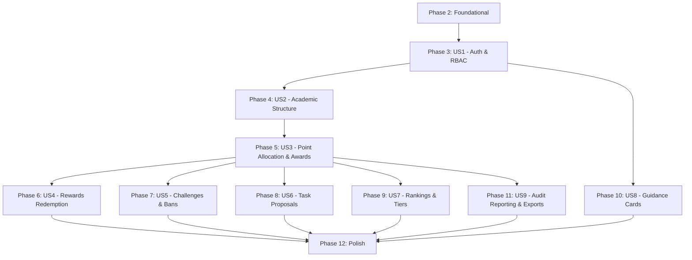

# Tasks: Student Reward System Backend

**Input**: Design documents from `specs/001-student-reward-backend/` (`spec.md`, `plan.md`, `data-model.md`, `research.md`, `quickstart.md`, `contracts/openapi.yaml`, `.specify/memory/constitution.md`).  
**Prerequisites**: Approved `spec.md` and `plan.md`.  
**Tests**: Automated tests included per `plan.md`, `quickstart.md`, and Constitution Principle VI covering unit algorithms, integration lifecycles, and OpenAPI contract compliance.  
**Organization**: Tasks are grouped into Setup, Foundational, 9 User Story phases, and Polish to enable independent implementation, testing, and delivery.

## Format: `[ID] [P?] [Story] Description with file path`

- **[P]**: Can run in parallel (different files, no dependencies on incomplete tasks)
- **[Story]**: User story identifier (`[US1]` through `[US9]`) for user story phases; omitted for Setup, Foundational, and Polish phases
- All tasks include exact file paths and verbatim constraints from `data-model.md` and `spec.md`

---

## Phase 1: Setup (Shared Infrastructure)

**Purpose**: Project initialization, dependency manifest, build tooling, and test environment configuration.

- [ ] T001 Create backend directory structure per implementation plan in `backend/`
- [ ] T002 Initialize `backend/package.json` with Node.js 24 LTS and TypeScript 5.x dependencies (`fastify`, `prisma`, `@prisma/client`, `@sinclair/typebox`, `@node-rs/argon2`, `ioredis`, `@fastify/cookie`, `@fastify/multipart`, `@fastify/swagger`, `@fastify/swagger-ui`, `@fastify/cors`, `pino`, `csv-stringify`, `exceljs`, `pdfkit`, `vitest`, `@vitest/coverage-v8`, `supertest`, `ioredis-mock`)
- [ ] T003 [P] Configure TypeScript compiler options in `backend/tsconfig.json`
- [ ] T004 [P] Configure Vitest test runner, test timeout, and coverage thresholds in `backend/vitest.config.ts`
- [ ] T005 [P] Setup environment variable configuration, defaults, and TypeBox schema validation in `backend/src/core/config.ts`

---

## Phase 2: Foundational (Blocking Prerequisites)

**Purpose**: Core infrastructure, database persistence schema, Redis session engine, observability, and authentication guards that MUST be complete before ANY user story can be implemented.

**⚠️ CRITICAL**: No user story work can begin until this foundational phase is complete.

- [ ] T006 Setup complete Prisma ORM schema with all 17 domain entities, SQLite WAL connection, and verbatim constraints (`Administrator`: `nationalId` String(10) unique regex `^\d{10}$`, `username` String(50) unique, `accountState` `Active`|`Inactive`; `Teacher`: `pointBalance` Integer check `>= 0`, `accountState` `Active`|`Deactivated`|`Departed`; `Student`: `currentPoints` check `>= 0`, `reservedPoints` check `>= 0`, `highestBalance` check `>= 0`, foreign key `classId`, foreign key `currentTierId`; `Class`: `name` String(50) unique; `Subject`: `name` String(50) unique; `TeacherClassSubject`: compound unique index on `(teacherId, classId, subjectId)`; `SystemPointPool`: singleton check `>= 0`; `PointTransferTask`: `name` String(100) unique; `PointTransferTaskOption`: check `pointAmount > 0`, compound unique index on `(taskId, pointAmount)`; `Reward`: `pointPrice > 0` immutable, check `inventory >= 0` nullable; `RewardRequest`: status enum `Pending to Approve`|`Pending to Receive`|`Completed`|`Declined`; `ChallengeMission`: `pointValue > 0` immutable, `completionLimit > 0`; `ActivityVerificationRequest`: evidence narrative + foreign keys; `VerificationAttachment`: check `sizeBytes > 0` and `<= 10485760`; `StudentActivityBan`: 30-day window; `StudentTaskProposal`: status enum `Pending to Approve`|`Ready to Do`|`Completed`|`Declined`|`Canceled`; `TaskProposalMessage`: role `STUDENT`|`ADMIN`; `PointEarningGuidanceCard`: predefined `logoId`; `StudentTier`: 5 tiers, `tierIndex` 1..5 unique, `minPoints >= 0`; `DailyStudentBalanceSnapshot`: compound unique on `(studentId, snapshotDate)`; `AuditRecord`: append-only immutable event log) in `backend/prisma/schema.prisma`
- [ ] T007 Execute initial Prisma migration and generate type-safe Prisma Client in `backend/prisma/migrations/`
- [ ] T008 [P] Implement Redis connection client with error handling and ping health check in `backend/src/core/redis.ts`
- [ ] T009 [P] Implement `ApplicationError` hierarchy with cause chaining, status codes, and standardized error response formatting per Constitution Principle VII in `backend/src/core/errors.ts`
- [ ] T010 [P] Implement Pino structured logger with credential and secret redaction (`password`, `passwordHash`, `token`, `sessionId`, `cookie`) in `backend/src/core/logger.ts`
- [ ] T011 [P] Implement request correlation identifier middleware (`X-Correlation-ID`) and lifecycle completion logging hooks (`onRequest`, `onResponse`, `onError`) in `backend/src/core/correlation.ts`
- [ ] T012 Implement Redis stateful session store, TTL management (7-day TTL), and instant multi-session revocation helper `revokeUserSessions(userId)` using `user_sessions:{userId}` in `backend/src/core/session.ts`
- [ ] T013 [P] Implement authentication middleware verifying Redis session and enforcing `accountState === 'Active'` in `backend/src/middleware/authenticate.ts`
- [ ] T014 [P] Implement role-based authorization guards for `ADMIN`, `TEACHER`, and `STUDENT` roles in `backend/src/middleware/authorize.ts`
- [ ] T015 Implement Fastify application factory registering plugins (`@fastify/cookie`, `@fastify/cors`, `@fastify/multipart`, `@fastify/swagger`, `@fastify/swagger-ui`), error handler, and correlation hooks in `backend/src/app.ts`
- [ ] T016 Implement server entrypoint with port binding, database connectivity, and graceful shutdown in `backend/src/server.ts`
- [ ] T017 Implement database seed script provisioning initial `SystemPointPool` balance (10,000 points), default 5 tiers (Tier 1 to 5), and baseline admin account in `backend/prisma/seed.ts`

**Checkpoint**: Foundation ready — database schema, Redis session management, observability hooks, and auth middleware are operational.

---

## Phase 3: User Story 1 - Account Provisioning & Role-Based Access Control (Priority: P1) 🎯 MVP

**Goal**: Provision school administrators, teachers, and students identified by unique 10-digit national IDs, authenticate with Argon2id passwords, manage Redis stateful sessions with signed cookies and Bearer token fallback, and enforce RBAC guards.

**Independent Test**: Provision initial admin via `/auth/provision-admin`, provision teachers and students via `/auth/users`, verify logins with valid credentials, confirm invalid credential rejection without user enumeration, and verify that students/teachers are blocked from admin-only routes.

### Tests for User Story 1

- [ ] T018 [P] [US1] Integration tests for admin provisioning, user account creation, Argon2id authentication, session cookie issuance, and RBAC rejection in `backend/tests/integration/auth-flow.test.ts`
- [ ] T019 [P] [US1] Integration test for instant 0-second session invalidation in Redis upon user state change to Inactive or Deactivated in `backend/tests/integration/session-invalidation.test.ts`

### Implementation for User Story 1

- [ ] T020 [P] [US1] Define TypeBox schemas for `/auth/provision-admin`, `/auth/users`, `/auth/login`, `/auth/logout`, and `/auth/me` with verbatim constraints (`nationalId` Regex `^\d{10}$`, `username` String(50), `firstName` String(50), `lastName` String(50), `role` enum `ADMIN`|`TEACHER`|`STUDENT`) in `backend/src/modules/auth/auth.schemas.ts`
- [ ] T021 [US1] Implement `AuthService` handling Argon2id password hashing, credential validation, Redis session generation, logout session destruction, and user retrieval in `backend/src/modules/auth/auth.service.ts`
- [ ] T022 [US1] Implement Fastify routes for `/auth/provision-admin`, `/auth/users`, `/auth/login`, `/auth/logout`, and `/auth/me` in `backend/src/modules/auth/auth.routes.ts`

**Checkpoint**: User Story 1 complete — system can authenticate all roles and enforce RBAC.

---

## Phase 4: User Story 2 - Academic Structure & Assignment Management (Priority: P1)

**Goal**: Manage classes and subjects, enforce single-class student enrollment, manage teacher-class-subject assignments, preserve student balances across class reassignment, handle student departure (balance zeroed, active requests removed, rankings excluded), handle teacher deactivation (balance and assignments preserved, action capabilities blocked, sessions purged), and handle teacher departure.

**Independent Test**: Create classes and subjects, assign students and teachers, reassign a student to a new class (confirming balance and requests are preserved), mark student departed (confirming balance zeroed and active requests removed), deactivate a teacher (confirming sessions purged and actions blocked), and restore teacher to active.

### Tests for User Story 2

- [ ] T023 [P] [US2] Integration tests for classes, subjects, teacher-class-subject assignments, single-class constraint, student reassignment, student departure, teacher deactivation session purge, and teacher departure in `backend/tests/integration/academic-flow.test.ts`

### Implementation for User Story 2

- [ ] T024 [P] [US2] Define TypeBox schemas for classes, subjects, student class assignment, student departure, teacher assignments, and teacher status in `backend/src/modules/academic/academic.schemas.ts`
- [ ] T025 [US2] Implement `AcademicService` with atomic transactions for class/subject creation, student single-class assignment, student reassignment (preserving points and requests), student departure cleanup (zeroing points, canceling active reward requests and open task proposals), teacher assignment management, and teacher status updates with instant Redis session revocation in `backend/src/modules/academic/academic.service.ts`
- [ ] T026 [US2] Implement Fastify routes for `/academic/classes`, `/academic/classes/:id/students`, `/academic/students/:id/class`, `/academic/students/:id/departure`, `/academic/subjects`, `/academic/assignments`, `/academic/assignments/:id`, and `/academic/teachers/:id/status` in `backend/src/modules/academic/academic.routes.ts`

**Checkpoint**: User Stories 1 and 2 complete — school structure and membership boundaries are active.

---

## Phase 5: User Story 3 - Point Allocation & Teacher Awarding Workflow (Priority: P1)

**Goal**: Enable administrators to fund teacher award budgets from the system point pool, configure point transfer tasks with predefined positive point options, enable teachers to award positive points to students in their assigned classes (validating budget and deducting balance), update student highest balance, evaluate dynamic tier updates, allow admin direct adjustments (preventing negative balances), and record permanent immutable audit log entries.

**Independent Test**: Fund teacher balance from system pool, define transfer task with options [5, 10, 15], award 10 points to an assigned student, verify teacher balance decrements by 10, verify student balance increases by 10, verify over-budget awards and cross-class awards are rejected, and verify audit records are created.

### Tests for User Story 3

- [ ] T027 [P] [US3] Integration tests for pool funding, transfer task definitions, teacher award eligibility, budget deduction, student balance addition, highest balance update, admin direct adjustment, negative balance rejection, and concurrent atomic awards in `backend/tests/integration/point-atomic.test.ts`

### Implementation for User Story 3

- [ ] T028 [P] [US3] Define TypeBox schemas for point pool transfer, task creation with positive options (`pointAmount > 0`), teacher point award, and admin direct adjustment in `backend/src/modules/points/points.schemas.ts`
- [ ] T029 [US3] Implement `PointsService` with atomic transactions for pool transfers, task management, teacher award validation (verifying active teacher, assigned class eligibility, and available budget), student balance increments, highest balance peak updates, tier re-evaluation, admin adjustments, and `AuditRecord` creation in `backend/src/modules/points/points.service.ts`
- [ ] T030 [US3] Implement Fastify routes for `/points/pool`, `/points/pool/transfer`, `/points/tasks`, `/points/award`, and `/points/adjust` in `backend/src/modules/points/points.routes.ts`

**Checkpoint**: User Stories 1, 2, and 3 complete — foundational point economy and award transactions are fully functional.

---

## Phase 6: User Story 4 - Reward Catalog Management & Redemption Lifecycle (Priority: P2)

**Goal**: Manage catalog rewards (fixed immutable price, finite inventory for non-approval rewards, no inventory limit for approval-required rewards), student reward requests with immediate point reservation, admin review (`Pending to Approve` -> `Pending to Receive` or `Declined`), admin receive confirmation (`Pending to Receive` -> `Completed`), points return on decline or catalog item removal, and rejection of student cancellations.

**Independent Test**: Create inventory-backed and approval-required rewards, request rewards as student (verifying immediate point reservation into `reservedPoints`), execute admin approval, decline request (verifying point return to balance), mark received after handover (verifying final completion), remove reward with active requests (verifying points return to students), and verify student cancellation is rejected.

### Tests for User Story 4

- [ ] T031 [P] [US4] Integration tests for reward CRUD, price immutability, inventory deductions, approval transitions, point reservations, return on decline, handover completion, catalog removal with active request cancellation, and student cancellation rejection in `backend/tests/integration/rewards-flow.test.ts`

### Implementation for User Story 4

- [ ] T032 [P] [US4] Define TypeBox schemas for reward catalog management and reward request lifecycle transitions (`requiresApproval`, `pointPrice > 0`, `inventory >= 0`, status `Pending to Approve`|`Pending to Receive`|`Completed`|`Declined`) in `backend/src/modules/rewards/rewards.schemas.ts`
- [ ] T033 [US4] Implement `RewardsService` with atomic transactions for reward creation, metadata updates (rejecting price modification), student requests (atomically reserving points and decrementing inventory), admin approval, admin decline (returning reserved points), admin completion (finalizing reserved points), and reward deletion (closing active requests and returning reserved points with audit logs) in `backend/src/modules/rewards/rewards.service.ts`
- [ ] T034 [US4] Implement Fastify routes for `/rewards`, `/rewards/:id`, `/rewards/requests`, `/rewards/requests/:id/approve`, `/rewards/requests/:id/decline`, and `/rewards/requests/:id/receive` in `backend/src/modules/rewards/rewards.routes.ts`

**Checkpoint**: User Stories 1 through 4 complete — reward redemption lifecycle is operational.

---

## Phase 7: User Story 5 - Challenges, Missions & Submission Abuse Prevention (Priority: P2)

**Goal**: Administrators create challenges and missions with immutable fixed point values and completion limits, students submit verification requests with text narrative and direct file/image attachments, administrators review submissions (accepting and awarding points, or rejecting), system tracks rejections and automatically triggers a 30-day submission ban on the 3rd rejection for that activity, and administrators can manually unban students.

**Independent Test**: Create a challenge with point value 20 and completion limit 1, submit verification request with file attachment, accept submission and verify points award, test rejection counter up to 3 rejections, confirm 4th submission is rejected with 403 Forbidden due to active ban, execute admin unban, and confirm student can submit again.

### Tests for User Story 5

- [ ] T035 [P] [US5] Unit tests for rejection counter evaluation, 30-day ban window calculation, and expiration logic in `backend/tests/unit/ban-calculator.test.ts`
- [ ] T036 [P] [US5] Integration tests for challenge/mission CRUD, multipart verification upload, review acceptance, rejection counting, automated 3-rejection ban trigger, and admin unban override in `backend/tests/integration/activities-flow.test.ts`

### Implementation for User Story 5

- [ ] T037 [P] [US5] Define TypeBox schemas for challenge/mission creation, multipart verification submissions (size `<= 10485760` bytes, MIME allowlist `image/jpeg`, `image/png`, `application/pdf`), review decisions, and admin unban in `backend/src/modules/activities/activities.schemas.ts`
- [ ] T038 [US5] Implement `ActivitiesService` handling activity CRUD, streaming upload file storage in `backend/src/uploads/`, verification acceptance by administrators (awarding points and updating highest balance), rejection tracking, automated 30-day `StudentActivityBan` creation on 3rd rejection, ban enforcement, and admin unban override in `backend/src/modules/activities/activities.service.ts`
- [ ] T039 [US5] Implement Fastify routes for `/activities`, `/activities/:id`, `/activities/:id/verifications`, `/activities/verifications/:id/review`, and `/activities/bans/:studentId/:activityId/unban` in `backend/src/modules/activities/activities.routes.ts`

**Checkpoint**: User Story 5 complete — challenges, missions, verification evidence, and abuse prevention bans are operational.

---

## Phase 8: User Story 6 - Student Voluntary Task Proposals & In-Request Messaging (Priority: P3)

**Goal**: Enable students to submit voluntary task proposals (`Pending to Approve`), allow administrators to decline or approve with an assigned positive point value (`Ready to Do`), allow administrators to adjust point amounts in `Ready to Do`, permit students to cancel proposals *only* while in `Ready to Do`, allow administrators to confirm completion (awarding points and updating highest balance), support bidirectional in-request message threads between student and administrators, restrict students strictly to viewing their own proposals, and strictly isolate teachers from proposal access (HTTP 403).

**Independent Test**: Submit proposal as student, confirm teacher querying proposals receives 403 Forbidden, approve proposal as admin with 25 points, post messages in the proposal thread as student and admin, cancel a proposal in `Ready to Do`, attempt to cancel a proposal in `Pending to Approve` (verifying rejection), confirm completion of another proposal (verifying 25 points transferred to student balance), and verify student cannot view another student's proposal.

### Tests for User Story 6

- [ ] T040 [P] [US6] Integration tests for proposal lifecycle state machine, point pricing and adjustments, student cancellation restrictions, completion point award, in-thread message exchange, student proposal query isolation, and teacher 403 access denial in `backend/tests/integration/proposals-flow.test.ts`

### Implementation for User Story 6

- [ ] T041 [P] [US6] Define TypeBox schemas for task proposal submission, review approval, point adjustment (`assignedPointValue > 0`), cancellation, completion, and message posting in `backend/src/modules/proposals/proposals.schemas.ts`
- [ ] T042 [US6] Implement `ProposalsService` with lifecycle state transitions (`Pending to Approve` -> `Ready to Do` -> `Completed`|`Declined`|`Canceled`), point pricing, student cancellation validation (allowed only in `Ready to Do`), completion point awards, student ownership query scoping, teacher access rejection, and message thread storage in `backend/src/modules/proposals/proposals.service.ts`
- [ ] T043 [US6] Implement Fastify routes for `/proposals`, `/proposals/:id`, `/proposals/:id/approve`, `/proposals/:id/points`, `/proposals/:id/cancel`, `/proposals/:id/complete`, and `/proposals/:id/messages` in `backend/src/modules/proposals/proposals.routes.ts`

**Checkpoint**: User Story 6 complete — voluntary task proposals and in-request messaging are fully functional.

---

## Phase 9: User Story 7 - Rankings, Tier Calculation & Daily Balance Snapshots (Priority: P3)

**Goal**: Calculate student rankings by current points using standard competition ranking (1224 with position skipping), support class and school-wide scopes, exclude inactive/deactivated/departed students, project privacy-safe student views (own rank, points, population count e.g. "15 of 32", and Top-N leaderboard with non-top students redacted), manage exactly 5 administrator-configured student tiers, evaluate dynamic tier updates upon balance changes, track highest balances, and record daily end-of-day balance snapshots.

**Independent Test**: Configure 5 tiers with thresholds, create active students with points [100, 80, 80, 50] and an inactive student with 90 points, verify rankings yield [1, 2, 2, 4] with inactive student excluded, query ranking as student (verifying own rank and top board only, without exposing non-top students), trigger daily snapshot, and verify end-of-day balances are saved in `daily_student_balance_snapshots`.

### Tests for User Story 7

- [ ] T044 [P] [US7] Unit tests for standard competition ranking (1224 with ties and skips) and student privacy projection in `backend/tests/unit/ranking.test.ts`
- [ ] T045 [P] [US7] Unit tests for dynamic 5-tier threshold resolution and highest-balance updates in `backend/tests/unit/tiers.test.ts`
- [ ] T046 [P] [US7] Integration tests for rankings API (class and school scopes), student privacy filtering, 5-tier configuration updates, and daily balance snapshot reconciliation in `backend/tests/integration/analytics-flow.test.ts`

### Implementation for User Story 7

- [ ] T047 [P] [US7] Define TypeBox schemas for rankings query parameters, top-student responses, tier configurations (enforcing exactly 5 tiers, `tierIndex` 1..5, `minPoints >= 0`), and daily balance history in `backend/src/modules/analytics/analytics.schemas.ts`
- [ ] T048 [US7] Implement `AnalyticsService` executing standard competition ranking (1224 algorithm), inactive student filtering, student privacy projection, dynamic tier threshold resolution, and daily balance snapshot reconciliation in `backend/src/modules/analytics/analytics.service.ts`
- [ ] T049 [US7] Implement Fastify routes for `/analytics/rankings`, `/analytics/tiers`, `/analytics/students/:id/history`, and `/analytics/snapshots/trigger` in `backend/src/modules/analytics/analytics.routes.ts`

**Checkpoint**: User Story 7 complete — rankings, tiers, and historical balance snapshots are operational.

---

## Phase 10: User Story 8 - Point Earning Guidance Cards (Priority: P4)

**Goal**: Enable administrators to create, update, and remove display-only guidance cards (title, description, predefined `logoId`, suggested point value or range), provide students with read-only query access, and reject student modification attempts.

**Independent Test**: Create guidance card as admin with title, description, logo, and point suggestion, retrieve cards as student, and verify student attempts to create, update, or delete cards return 403 Forbidden.

### Tests for User Story 8

- [ ] T050 [P] [US8] Integration tests for guidance card admin CRUD, student read-only query access, and rejection of student mutation requests in `backend/tests/integration/guidance-flow.test.ts`

### Implementation for User Story 8

- [ ] T051 [P] [US8] Define TypeBox schemas for guidance cards creation, update, and list response (`title` String(100), `description` Text, `logoId` String(50), `suggestedPointsText` String(50)) in `backend/src/modules/guidance/guidance.schemas.ts`
- [ ] T052 [US8] Implement `GuidanceService` handling guidance card CRUD and enforcing student read-only access in `backend/src/modules/guidance/guidance.service.ts`
- [ ] T053 [US8] Implement Fastify routes for `/guidance/cards` and `/guidance/cards/:id` in `backend/src/modules/guidance/guidance.routes.ts`

**Checkpoint**: User Story 8 complete — guidance cards are operational.

---

## Phase 11: User Story 9 - Immutable Audit Logging & Role-Based Filtered Reporting (Priority: P1)

**Goal**: Permanently record an immutable audit log for every point-flow event (pool transfer, teacher award, admin adjustment, reward reservation, reward completion, reward decline return, reward catalog removal return, challenge award, proposal award), reject UPDATE/DELETE operations on audit logs, provide on-demand parameterized reporting with runtime filters (date range, student, teacher, class, subject, action type, reward, tier), enforce role-scoped visibility (Admin: school-wide; Teacher: assigned classes only; Student: own records only), and generate streaming export files in CSV, Excel, and PDF formats.

**Independent Test**: Query audit report as admin with filters, query as teacher (confirming only assigned students are returned), query as student (confirming only own records are returned), attempt to modify or delete an audit record (confirming rejection), and generate valid CSV, Excel, and PDF exports.

### Tests for User Story 9

- [ ] T054 [P] [US9] Integration tests confirming audit trail immutability, rejection of modifications/deletions, and role-based report scoping in `backend/tests/integration/audit-immutability.test.ts`
- [ ] T055 [P] [US9] Integration tests for parameterized reporting filters and CSV, Excel, and PDF export generation in `backend/tests/integration/reporting-flow.test.ts`

### Implementation for User Story 9

- [ ] T056 [P] [US9] Define TypeBox schemas for point-flow report filter query parameters and export format parameter (`format` enum `csv`|`excel`|`pdf`) in `backend/src/modules/reporting/reporting.schemas.ts`
- [ ] T057 [P] [US9] Implement streaming CSV export adapter using `csv-stringify` in `backend/src/modules/reporting/exporters/csv.exporter.ts`
- [ ] T058 [P] [US9] Implement styled Excel workbook export adapter using `exceljs` in `backend/src/modules/reporting/exporters/excel.exporter.ts`
- [ ] T059 [P] [US9] Implement tabular PDF report export adapter with summary headers using `pdfkit` in `backend/src/modules/reporting/exporters/pdf.exporter.ts`
- [ ] T060 [US9] Implement `ReportingService` executing parameterized queries over `AuditRecord`, enforcing role-based scoping (admin school-wide, teacher assigned classes, student self), and dispatching export streams in `backend/src/modules/reporting/reporting.service.ts`
- [ ] T061 [US9] Implement Fastify routes for `/reports/point-flow` and `/reports/point-flow/export` in `backend/src/modules/reporting/reporting.routes.ts`

**Checkpoint**: User Story 9 complete — audit logging, role-filtered reporting, and multi-format exports are fully functional.

---

## Phase 12: Polish & Cross-Cutting Concerns

**Purpose**: OpenAPI contract adherence verification, full quickstart scenario validation, security/redaction checks, and final build validation.

- [ ] T062 [P] Implement automated OpenAPI contract adherence test validating route schemas against `specs/001-student-reward-backend/contracts/openapi.yaml` in `backend/tests/contract/openapi-adherence.test.ts`
- [ ] T063 [P] Implement automated end-to-end integration test executing all 10 quickstart scenarios from `quickstart.md` in `backend/tests/integration/quickstart-scenarios.test.ts`
- [ ] T064 [P] Implement automated security test verifying zero exposure of passwords, hashes, tokens, or credentials in logs, error payloads, and audit records in `backend/tests/unit/redaction.test.ts`
- [ ] T065 Run complete TypeScript typecheck, ESLint validation, and full Vitest test suite with coverage report

---

## Dependencies & Execution Order

### Phase Dependencies

- **Phase 1 (Setup)**: No dependencies — executes immediately.
- **Phase 2 (Foundational)**: Depends on Phase 1 completion — **BLOCKS all user stories**.
- **Phase 3 (User Story 1 - P1 🎯 MVP)**: Depends on Phase 2 completion. Unblocks core authentication and user context.
- **Phase 4 (User Story 2 - P1)**: Depends on Phase 3 (US1). Establishes academic classes, subjects, and teacher-class assignments.
- **Phase 5 (User Story 3 - P1)**: Depends on Phase 4 (US2). Requires teacher assignments to validate award eligibility.
- **Phase 6 (User Story 4 - P2)**: Depends on Phase 5 (US3). Operates on student point balances established in US3.
- **Phase 7 (User Story 5 - P2)**: Depends on Phase 5 (US3). Awards points for challenge/mission verifications.
- **Phase 8 (User Story 6 - P3)**: Depends on Phase 5 (US3). Awards points upon voluntary proposal completion.
- **Phase 9 (User Story 7 - P3)**: Depends on Phase 5 (US3). Ranks students and tracks daily balances based on point transactions.
- **Phase 10 (User Story 8 - P4)**: Depends on Phase 3 (US1). Guidance cards require admin authorization and student read access.
- **Phase 11 (User Story 9 - P1)**: Depends on Phase 5 (US3). Queries and exports immutable audit logs generated across point transactions.
- **Phase 12 (Polish)**: Depends on all user story phases (Phases 3–11) being complete.

### User Story Dependencies



### Within Each User Story Phase

1. **Tests FIRST**: Integration and unit tests written and confirmed failing before implementation.
2. **Schemas**: TypeBox request and response validation schemas defined.
3. **Service Logic**: Domain service implementing business rules, atomic transactions, and audit records.
4. **Routes**: Fastify route definitions with schemas, auth middleware, and handlers.
5. **Checkpoint**: Story verified independently.

### Parallel Opportunities

- **Phase 1**: Tasks T003, T004, and T005 can execute in parallel.
- **Phase 2**: Tasks T008, T009, T010, T011, T013, and T014 can execute in parallel once T006 and T007 complete.
- **Phase 3 (US1)**: Test tasks T018 and T019, and schema task T020 can execute in parallel.
- **Phase 4 (US2)**: Test task T023 and schema task T024 can execute in parallel.
- **Phase 5 (US3)**: Test task T027 and schema task T028 can execute in parallel.
- **Phase 6 (US4)**: Test task T031 and schema task T032 can execute in parallel.
- **Phase 7 (US5)**: Unit test T035, integration test T036, and schema task T037 can execute in parallel.
- **Phase 8 (US6)**: Test task T040 and schema task T041 can execute in parallel.
- **Phase 9 (US7)**: Unit tests T044, T045, integration test T046, and schema task T047 can execute in parallel.
- **Phase 10 (US8)**: Test task T050 and schema task T051 can execute in parallel.
- **Phase 11 (US9)**: Test tasks T054, T055, schema task T056, and exporter adapters T057, T058, T059 can all execute in parallel.
- **Phase 12**: Tasks T062, T063, and T064 can execute in parallel.
- **Cross-Story Parallelism**: After Phase 5 (US3) completes, User Stories 4, 5, 6, 7, 8, and 9 can proceed in parallel across separate feature modules.

---

## Parallel Example: User Story 1 (Auth & RBAC)

```bash
# Launch test and schema tasks for User Story 1 together:
Task: "Integration tests for admin provisioning, user account creation, Argon2id authentication, session cookie issuance, and RBAC rejection in backend/tests/integration/auth-flow.test.ts" (T018)
Task: "Integration test for instant 0-second session invalidation in Redis upon user state change to Inactive or Deactivated in backend/tests/integration/session-invalidation.test.ts" (T019)
Task: "Define TypeBox schemas for /auth/provision-admin, /auth/users, /auth/login, /auth/logout, and /auth/me in backend/src/modules/auth/auth.schemas.ts" (T020)
```

## Parallel Example: User Story 9 (Reporting Exporters)

```bash
# Launch all three exporter adapters in parallel:
Task: "Implement streaming CSV export adapter using csv-stringify in backend/src/modules/reporting/exporters/csv.exporter.ts" (T057)
Task: "Implement styled Excel workbook export adapter using exceljs in backend/src/modules/reporting/exporters/excel.exporter.ts" (T058)
Task: "Implement tabular PDF report export adapter with summary headers using pdfkit in backend/src/modules/reporting/exporters/pdf.exporter.ts" (T059)
```

---

## Implementation Strategy

### MVP First (Phases 1, 2, and 3 - User Story 1)

1. Complete **Phase 1: Setup** (workspace, dependencies, build configs).
2. Complete **Phase 2: Foundational** (Prisma ORM schema, Redis session store, correlation ID, Pino logger, auth middleware, seed data).
3. Complete **Phase 3: User Story 1** (Admin provisioning, user management, 10-digit national ID login, session cookies, RBAC).
4. **STOP and VALIDATE**: Run `npm test` against `auth-flow.test.ts` and `session-invalidation.test.ts`. Verify MVP authentication works end-to-end.

### Incremental Delivery

1. **Foundation & MVP (US1)**: Provision accounts, authenticate, issue session cookies, verify RBAC.
2. **Academic Structure (US2)**: Add classes, subjects, teacher assignments, student reassignment, and teacher deactivation session purge.
3. **Core Economy (US3)**: Add system pool, transfer tasks, teacher awards, atomic balances, tier triggers, and immutable audit logs.
4. **Catalog & Redemption (US4)**: Add reward catalog, instant point reservations, handover completion, and return on decline/deletion.
5. **Engagement & Protection (US5)**: Add challenges/missions, multipart proof uploads, review flows, and 3-rejection abuse bans.
6. **Student Initiative (US6)**: Add voluntary task proposals, admin pricing, student cancellation, and isolated message threads.
7. **Analytics & Motivation (US7)**: Add standard competition ranking (1224), student privacy projection, 5-tier classification, and daily snapshots.
8. **Guidance (US8)**: Add display-only guidance cards.
9. **Compliance & Reporting (US9)**: Add role-scoped audit queries and streaming multi-format exports (CSV, Excel, PDF).
10. **Final Polish (Phase 12)**: Validate OpenAPI contract adherence, run all 10 quickstart scenarios, verify secret redaction, and run full test coverage.
