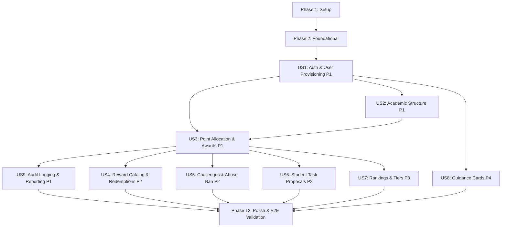

# Tasks: Student Reward System Backend

**Input**: Design documents from `/specs/001-student-reward-backend/` (`spec.md`, `plan.md`, `data-model.md`, `contracts/openapi.yaml`, `research.md`, `quickstart.md`) and requirements from `/docs/requirements/`

**Prerequisites**: plan.md (required), spec.md (required for user stories), research.md, data-model.md, contracts/openapi.yaml, quickstart.md

**Tests**: Comprehensive contract, integration, and E2E test tasks are included per story in alignment with the test scenarios in `spec.md` and `quickstart.md`.

**Organization**: Tasks are grouped by phase and user story to enable independent implementation, testing, and delivery of each story.

## Format: `[ID] [P?] [Story] Description`

- **[P]**: Can run in parallel (different files, no dependencies)
- **[Story]**: Which user story this task belongs to (e.g., [US1], [US2], [US3]...)
- All task descriptions include exact file paths and quote data constraints verbatim.

---

## Phase 1: Setup (Shared Infrastructure)

**Purpose**: Project initialization, dependency management, container services, and developer tooling configuration.

- [ ] T001 Initialize backend Node.js/TypeScript project structure with NestJS dependencies (`@nestjs/core`, `@nestjs/common`, `@nestjs/swagger`, `@nestjs/config`, `@nestjs/schedule`, `prisma`, `ioredis`, `argon2`, `class-validator`, `class-transformer`, `fast-csv`, `exceljs`, `pdfmake`, `@aws-sdk/client-s3`) in `backend/package.json`, `backend/tsconfig.json`, and `backend/nest-cli.json`
- [ ] T002 [P] Configure Docker Compose environment for PostgreSQL 16 (`student_rewards` database on port 5432), Redis 7 (port 6379), and MinIO S3 container (ports 9000/9001) in `backend/docker-compose.yml`
- [ ] T003 [P] Configure environment variables schema and validation using `@nestjs/config` (`PORT`, `DATABASE_URL`, `REDIS_URL`, `STORAGE_PROVIDER`, `MINIO_ENDPOINT`, `MINIO_ACCESS_KEY`, `MINIO_SECRET_KEY`, `SESSION_SECRET`, `SESSION_TTL_SECONDS`, `ACTIVITY_BAN_DURATION_DAYS` integer with default 30) in `backend/src/config/env.config.ts`
- [ ] T004 [P] Configure ESLint, Prettier, and TypeScript compiler options in `backend/.eslintrc.js` and `backend/.prettierrc`
- [ ] T005 [P] Setup Jest and Supertest test configurations for unit, contract, integration, and E2E test runners in `backend/jest.config.ts` and `backend/test/jest-e2e.json`

---

## Phase 2: Foundational (Blocking Prerequisites)

**Purpose**: Core data layer, session management, security guards, cross-cutting observability, and exception handling that MUST be complete before ANY user story can be implemented.

**⚠️ CRITICAL**: No user story work can begin until this phase is complete.

- [ ] T006 Define complete Prisma relational schema with all 15 models (`User`, `TeacherProfile`, `StudentProfile`, `Class`, `Subject`, `TeacherClassSubjectAssignment`, `SystemPointPool`, `PointTransferTask`, `PointTaskOption`, `PointAuditLog`, `Reward`, `RewardRequest`, `Activity`, `VerificationRequest`, `StudentActivityProgress`, `StudentTaskProposal`, `TaskProposalMessage`, `TierConfiguration`, `DailyStudentBalanceSnapshot`, `GuidanceCard`) enforcing database constraints verbatim: `CHECK (national_id ~ '^[0-9]{10}$')`, `CHECK (point_balance >= 0)`, `CHECK (current_balance >= 0)`, `CHECK (reserved_balance >= 0)`, `CHECK (balance >= 0)`, `CHECK (points > 0)`, `CHECK (point_price > 0)`, `CHECK (completion_limit > 0)`, `CHECK (assigned_point_value > 0)`, `CHECK (tier_number BETWEEN 1 AND 5)`, `CHECK (min_points_threshold >= 0)`, and generate initial migration in `backend/prisma/schema.prisma` and `backend/prisma/migrations/0_init/migration.sql`
- [ ] T007 [P] Implement Prisma service and database lifecycle connection manager in `backend/src/common/prisma/prisma.service.ts` and `backend/src/common/prisma/prisma.module.ts`
- [ ] T008 [P] Implement Redis connection service and stateful session manager with TTL support in `backend/src/common/redis/redis.service.ts` and `backend/src/common/redis/redis.module.ts`
- [ ] T009 [P] Implement Storage service abstraction (`StorageService` interface, `LocalStorageService` saving to `uploads/`, and `MinioS3StorageService` using `@aws-sdk/client-s3`) in `backend/src/modules/storage/storage.service.ts` and `backend/src/modules/storage/storage.module.ts`
- [ ] T010 [P] Implement Request Correlation ID middleware generating and propagating `X-Correlation-Id` UUID v4 header across all request lifecycles (FR-072, FR-073) in `backend/src/common/middleware/correlation.middleware.ts`
- [ ] T011 [P] Implement Structured JSON Request Logging Interceptor with sensitive credential/token scrubbing (FR-074, FR-075) in `backend/src/common/interceptors/logging.interceptor.ts`
- [ ] T012 [P] Implement Global Exception Filter transforming HttpException and unexpected errors into standardized `ErrorResponse` ({ `statusCode`, `errorCode`, `message`, `correlationId`, `timestamp` }) preserving error cause (Constitution Principle VII) in `backend/src/common/filters/global-exception.filter.ts`
- [ ] T013 [P] Implement Auth Guards and Role Decorators (`SessionAuthGuard`, `RolesGuard`, `@Roles('ADMIN' | 'TEACHER' | 'STUDENT')`, `@CurrentUser()`) in `backend/src/common/guards/session-auth.guard.ts`, `backend/src/common/guards/roles.guard.ts`, and `backend/src/common/decorators/roles.decorator.ts`
- [ ] T014 Implement Bootstrap Application Entry Point configuring Swagger/OpenAPI at `/docs`, global ValidationPipe (`whitelist: true, forbidNonWhitelisted: true, transform: true`), CORS, and root module wiring in `backend/src/main.ts` and `backend/src/app.module.ts`

**Checkpoint**: Foundation ready - user story implementation can now begin.

---

## Phase 3: User Story 1 - Account Provisioning & Role-Based Access Control (Priority: P1) 🎯 MVP

**Goal**: Provision initial administrator, create accounts for administrators, teachers, and students identified by 10-digit national IDs (`^[0-9]{10}$`), Argon2id password hashing, stateful Redis session login/logout, and RBAC enforcement across all roles.

**Independent Test**: Provision the first admin via `/api/v1/auth/initial-admin`, authenticate via `/api/v1/auth/login`, create teacher and student accounts via `/api/v1/users`, verify invalid credential rejections without leaking details, and confirm role-based guard authorization rejections on unauthorized endpoints.

### Tests for User Story 1 ⚠️

- [ ] T015 [P] [US1] Contract tests for authentication and user endpoints (`POST /api/v1/auth/initial-admin`, `POST /api/v1/auth/login`, `POST /api/v1/auth/logout`, `GET /api/v1/auth/me`, `POST /api/v1/users`, `GET /api/v1/users`) in `backend/test/contract/auth-users.contract-spec.ts`
- [ ] T016 [P] [US1] Integration tests for 10-digit national ID validation, Argon2id credential hashing, stateful Redis session lifecycle with TTL, and RBAC guard access rejection for unauthorized roles in `backend/test/integration/auth-rbac.integration-spec.ts`

### Implementation for User Story 1

- [ ] T017 [P] [US1] Create DTOs with `class-validator` rules for InitialAdminDto, LoginDto (`nationalId` regex `^[0-9]{10}$`), CreateUserDto (`nationalId` regex `^[0-9]{10}$`, `firstName` max 100, `lastName` max 100, `username` max 50, `role` enum `ADMIN | TEACHER | STUDENT`, `accountState` enum `ACTIVE | INACTIVE | DEACTIVATED | DEPARTED`), and UserResponseDto in `backend/src/modules/auth/dto/auth.dto.ts` and `backend/src/modules/users/dto/user.dto.ts`
- [ ] T018 [P] [US1] Implement PasswordService using `argon2` for secure hashing (`argon2id`) and constant-time password verification in `backend/src/modules/auth/password.service.ts`
- [ ] T019 [US1] Implement AuthService handling initial admin bootstrap (FR-001), credential verification against `User` table (FR-003, FR-004), Redis session token creation with TTL (FR-004), session validation, and logout invalidation in `backend/src/modules/auth/auth.service.ts`
- [ ] T020 [US1] Implement UsersService for administrator-managed provisioning of admin, teacher, and student accounts, creating associated `TeacherProfile` (initial `point_balance = 0`) or `StudentProfile` (initial `current_balance = 0, reserved_balance = 0, highest_balance = 0`), and querying users in `backend/src/modules/users/users.service.ts`
- [ ] T021 [P] [US1] Implement AuthController (`POST /api/v1/auth/initial-admin`, `POST /api/v1/auth/login`, `POST /api/v1/auth/logout`, `GET /api/v1/auth/me`) with session cookie and Bearer header support in `backend/src/modules/auth/auth.controller.ts`
- [ ] T022 [P] [US1] Implement UsersController (`POST /api/v1/users`, `GET /api/v1/users`, `GET /api/v1/users/:id`, `PATCH /api/v1/users/:id/state`) guarded by `@Roles('ADMIN')` in `backend/src/modules/users/users.controller.ts`
- [ ] T023 [US1] Wire AuthModule and UsersModule with Prisma and Redis dependencies in `backend/src/modules/auth/auth.module.ts` and `backend/src/modules/users/users.module.ts`

**Checkpoint**: At this point, User Story 1 is fully functional and testable independently (MVP core identity & security).

---

## Phase 4: User Story 2 - Academic Structure & Assignment Management (Priority: P1)

**Goal**: Manage classes and subjects, enforce single class enrollment per student, handle student reassignment while preserving points and active requests, assign teachers to classes by subject, and handle teacher/student deactivations and departures.

**Independent Test**: Create classes and subjects, assign students and teachers, reassign a student with existing points and active requests to a new class (verifying records remain intact), mark a student as departed (verifying balance removal and request cancellation), and deactivate/remove teachers (verifying balance preservation vs departure cleanup).

### Tests for User Story 2 ⚠️

- [ ] T024 [P] [US2] Contract tests for academic endpoints (`POST/GET/PATCH/DELETE /api/v1/classes`, `POST/GET/DELETE /api/v1/subjects`, `POST/GET/DELETE /api/v1/assignments`) in `backend/test/contract/academic.contract-spec.ts`
- [ ] T025 [P] [US2] Integration tests for single-class constraint, class reassignment preserving student balances and active requests, student departure cleanup, teacher multi-subject assignments, and teacher deactivation/departure lifecycle in `backend/test/integration/academic-lifecycle.integration-spec.ts`

### Implementation for User Story 2

- [ ] T026 [P] [US2] Create DTOs with validation rules for CreateClassDto (`name` VARCHAR(100) UNIQUE, `gradeLevel` VARCHAR(50) nullable, `description` TEXT nullable), UpdateClassDto, CreateSubjectDto (`name` VARCHAR(100) UNIQUE, `description` TEXT nullable), CreateAssignmentDto (`teacherId` UUID, `classId` UUID, `subjectId` UUID), and AssignStudentClassDto (`studentId` UUID, `classId` UUID) in `backend/src/modules/academic/dto/academic.dto.ts`
- [ ] T027 [US2] Implement AcademicService handling Class CRUD (FR-007, FR-079), Subject CRUD (FR-007, FR-080), student single-class assignment and class reassignment preserving balances and requests (FR-008, FR-009), student departure cleanup (FR-010), teacher-class-subject multi-assignment management with unique active triplet constraint (FR-011, FR-013, FR-081), and teacher deactivation/departure handling (FR-012, FR-014) in `backend/src/modules/academic/academic.service.ts`
- [ ] T028 [P] [US2] Implement ClassesController (`/api/v1/classes`), SubjectsController (`/api/v1/subjects`), and AssignmentsController (`/api/v1/assignments`) with `@Roles('ADMIN')` and `@Roles('TEACHER', 'ADMIN')` guards in `backend/src/modules/academic/classes.controller.ts`, `backend/src/modules/academic/subjects.controller.ts`, and `backend/src/modules/academic/assignments.controller.ts`
- [ ] T029 [US2] Wire AcademicModule with Prisma dependencies in `backend/src/modules/academic/academic.module.ts`

**Checkpoint**: User Stories 1 and 2 work together independently.

---

## Phase 5: User Story 3 - Point Allocation & Teacher Awarding Workflow (Priority: P1)

**Goal**: Fund teacher award budgets from the system point pool, define point transfer tasks with discrete positive point options, award points atomically from teachers to eligible assigned students, prevent over-budget and cross-class awards, and support admin direct adjustments with immutable audit logging.

**Independent Test**: Fund a teacher's budget from the pool, create a transfer task with predefined options, award points as a teacher to a student in an assigned class, verify balances update and audit log is written, verify award to an unassigned class student fails, verify award exceeding teacher budget fails, and verify admin direct balance adjustments.

### Tests for User Story 3 ⚠️

- [ ] T030 [P] [US3] Contract tests for point pool funding, task definitions, teacher award, and admin balance adjustment endpoints (`POST /api/v1/points/pool/fund-teacher`, `POST/GET/PATCH/DELETE /api/v1/points/tasks`, `POST /api/v1/points/teacher-award`, `POST /api/v1/points/admin-adjust`) in `backend/test/contract/points.contract-spec.ts`
- [ ] T031 [P] [US3] Integration tests for interactive Prisma transactions (`$transaction`), non-negative balance checks (`CHECK (point_balance >= 0)`, `CHECK (current_balance >= 0)`), teacher award budget limits, cross-class eligibility checks, custom task/point rejection, and highest balance peak updates in `backend/test/integration/points-awarding.integration-spec.ts`

### Implementation for User Story 3

- [ ] T032 [P] [US3] Create DTOs with validation rules for FundTeacherBudgetDto (`teacherId` UUID, `amount` INTEGER > 0), CreatePointTaskDto (`name` VARCHAR(150) UNIQUE, `description` TEXT nullable, `options` array of { `points` INTEGER > 0, `label` VARCHAR(100) nullable }), TeacherAwardPointsDto (`studentId` UUID, `classId` UUID, `subjectId` UUID, `taskId` UUID, `optionId` UUID), and AdminAdjustStudentBalanceDto (`studentId` UUID, `amount` INTEGER non-zero, `reason` TEXT NOT NULL) in `backend/src/modules/points/dto/points.dto.ts`
- [ ] T033 [US3] Implement PointsService handling atomic interactive transactions for pool funding (FR-015, FR-016), task definition CRUD (FR-017), teacher award eligibility and execution enforcing assignment check and budget check (FR-018, FR-019, FR-020, FR-021, FR-022), admin direct student adjustments (FR-023), student `highest_balance` tracking (FR-059), and writing append-only `PointAuditLog` entries in `backend/src/modules/points/points.service.ts`
- [ ] T034 [P] [US3] Implement PointsController (`POST /api/v1/points/pool/fund-teacher`, `POST/GET/PATCH/DELETE /api/v1/points/tasks`, `POST /api/v1/points/teacher-award`, `POST /api/v1/points/admin-adjust`) with role guards in `backend/src/modules/points/points.controller.ts`
- [ ] T035 [US3] Wire PointsModule with Prisma and Common modules in `backend/src/modules/points/points.module.ts`

**Checkpoint**: Point allocation and teacher awarding economy is fully operational.

---

## Phase 6: User Story 9 - Immutable Audit Logging & Role-Based Filtered Reporting (Priority: P1)

**Goal**: Permanently record immutable audit entries for all point-modifying events, prevent updates/deletions at application and database layer, and provide role-scoped on-demand reporting exportable to CSV, Excel (XLSX), and PDF.

**Independent Test**: Execute various point transactions, confirm attempts to update or delete audit records are rejected, query point flow reports with runtime filters (date range, student, teacher, class, subject, action type, reward, tier), verify teachers only see their assigned students, verify students only see their own records, and generate CSV, XLSX, and PDF export streams.

### Tests for User Story 9 ⚠️

- [ ] T036 [P] [US9] Contract tests for audit log query and streaming export endpoints (`GET /api/v1/reports/point-flow`, `GET /api/v1/reports/point-flow/export?format=csv|xlsx|pdf`) in `backend/test/contract/reports.contract-spec.ts`
- [ ] T037 [P] [US9] Integration tests for audit log immutability (rejection of update/delete operations), role-based scoping filters (admin school-wide, teacher assigned classes, student self only), and multi-format streaming export generation in `backend/test/integration/reports-audit.integration-spec.ts`

### Implementation for User Story 9

- [ ] T038 [P] [US9] Implement AuditLogService providing append-only write and query methods for `PointAuditLog`, enforcing immutability by rejecting any update or delete invocations (FR-066, FR-067, FR-068, FR-083, FR-095) in `backend/src/modules/points/audit-log.service.ts`
- [ ] T039 [P] [US9] Implement export format utility generators using `fast-csv` (CSV stream), `exceljs` (XLSX workbook buffer), and `pdfmake` (PDF document stream) with standardized tabular headers in `backend/src/common/utils/export.util.ts`
- [ ] T040 [US9] Implement ReportsService with runtime parameter filtering (`startDate`, `endDate`, `studentId`, `teacherId`, `classId`, `subjectId`, `actionType`, `rewardId`, `tierId`), enforcing role-based visibility scoping (FR-069, FR-070, FR-071) in `backend/src/modules/reports/reports.service.ts`
- [ ] T041 [P] [US9] Implement ReportsController (`GET /api/v1/reports/point-flow`, `GET /api/v1/reports/point-flow/export`) with appropriate MIME type headers (`text/csv`, `application/vnd.openxmlformats-officedocument.spreadsheetml.sheet`, `application/pdf`) and role guards in `backend/src/modules/reports/reports.controller.ts`
- [ ] T042 [US9] Wire ReportsModule with Prisma and Common modules in `backend/src/modules/reports/reports.module.ts`

**Checkpoint**: Immutable audit ledger and role-scoped reporting exports are complete.

---

## Phase 7: User Story 4 - Reward Catalog Management & Redemption Lifecycle (Priority: P2)

**Goal**: Manage catalog rewards with immutable point prices (`point_price > 0`), handle student redemption requests with immediate balance reservation and inventory deduction, manage request lifecycle (`Pending to Approve` / `Pending to Receive` -> `Completed` / `Declined`), return reserved points on declines or reward removal, and prevent student cancellations.

**Independent Test**: Create approval-required and non-approval rewards, submit student requests (verifying available balance decreases and reserved balance increases), verify concurrent inventory deduction, approve/decline requests as admin, mark physical receive handover as completed, verify point return when a reward is removed from catalog, and confirm student cancellation attempts fail.

### Tests for User Story 4 ⚠️

- [ ] T043 [P] [US4] Contract tests for reward catalog and request lifecycle endpoints (`POST/GET/PATCH/DELETE /api/v1/rewards`, `POST/GET /api/v1/reward-requests`, `POST /api/v1/reward-requests/:id/approve`, `POST /api/v1/reward-requests/:id/decline`, `POST /api/v1/reward-requests/:id/receive`) in `backend/test/contract/rewards.contract-spec.ts`
- [ ] T044 [P] [US4] Integration tests for atomic point reservation (`CHECK (reserved_balance >= 0)`), price immutability checks, concurrent inventory depletion, admin approval and decline point refunds, physical handover completion, catalog removal cascading point returns, and rejection of student cancellation in `backend/test/integration/rewards-lifecycle.integration-spec.ts`

### Implementation for User Story 4

- [ ] T045 [P] [US4] Create DTOs with validation rules for CreateRewardDto (`name` VARCHAR(150), `description` TEXT, `imageUrl` VARCHAR(500) nullable, `pointPrice` INTEGER > 0, `requiresApproval` BOOLEAN, `inventoryQuantity` INTEGER >= 0 nullable for non-approval), UpdateRewardMetadataDto (excluding price), CreateRewardRequestDto (`rewardId` UUID), and DeclineRewardRequestDto (`declineReason` TEXT nullable) in `backend/src/modules/rewards/dto/rewards.dto.ts`
- [ ] T046 [US4] Implement RewardsService handling catalog management (FR-024, FR-085), price immutability rejection on update (FR-025), catalog removal with automatic request closure & point refunds (FR-034), student reward request with immediate point reservation & inventory decrement (FR-026, FR-027, FR-028, FR-030, FR-031, FR-086), rejection of student cancellation (FR-029), admin approval transitioning `PENDING_TO_APPROVE` to `PENDING_TO_RECEIVE` (FR-032), admin decline returning reserved points to student current balance (FR-032), and admin physical handover completion finalizing point reservation (FR-033) in `backend/src/modules/rewards/rewards.service.ts`
- [ ] T047 [P] [US4] Implement RewardsController (`/api/v1/rewards`) and RewardRequestsController (`/api/v1/reward-requests`) with role-scoped endpoints (`@Roles('ADMIN')`, `@Roles('STUDENT')`) in `backend/src/modules/rewards/rewards.controller.ts` and `backend/src/modules/rewards/reward-requests.controller.ts`
- [ ] T048 [US4] Wire RewardsModule with Prisma, Points, and Storage modules in `backend/src/modules/rewards/rewards.module.ts`

**Checkpoint**: Reward catalog and redemption lifecycle is completely functional.

---

## Phase 8: User Story 5 - Challenges, Missions & Submission Abuse Prevention (Priority: P2)

**Goal**: Create fixed-value challenges and missions (`point_value > 0`, `completion_limit > 0`, immutable point value), allow student verification submissions with text and file upload evidence, award points on admin verification acceptance, track rejections and apply a dynamic submission ban (`ACTIVITY_BAN_DURATION_DAYS`, default: 30 days) upon 3rd rejection, and support admin manual unban overrides.

**Independent Test**: Create challenges/missions, submit verification requests with text and file evidence, accept submissions up to completion limit and verify point awards, reject 3 submissions for the same activity and verify dynamic ban blocks further submissions, and execute admin unban restoring submission eligibility.

### Tests for User Story 5 ⚠️

- [ ] T049 [P] [US5] Contract tests for activities, submissions, review, and unban endpoints (`POST/GET/PATCH/DELETE /api/v1/activities`, `POST/GET /api/v1/activities/:id/submissions`, `POST /api/v1/verifications/:id/accept`, `POST /api/v1/verifications/:id/reject`, `POST /api/v1/students/:id/unban`) in `backend/test/contract/activities.contract-spec.ts`
- [ ] T050 [P] [US5] Integration tests for fixed point immutability, evidence file upload storage, per-student completion limits, rejection counter tracking, 3-rejection dynamic ban trigger (`ACTIVITY_BAN_DURATION_DAYS` default 30 days), submission ban blocking, and admin manual unban in `backend/test/integration/activities-ban.integration-spec.ts`

### Implementation for User Story 5

- [ ] T051 [P] [US5] Create DTOs with validation rules for CreateActivityDto (`type` enum `CHALLENGE | MISSION`, `title` VARCHAR(150), `description` TEXT, `pointValue` INTEGER > 0, `completionLimit` INTEGER > 0, `status` enum `ACTIVE | INACTIVE | REMOVED`), UpdateActivityMetadataDto (excluding point value), SubmitVerificationDto (`textDescription` TEXT, `fileAttachmentUrl` VARCHAR(500) nullable), RejectVerificationDto (`rejectionReason` TEXT nullable), and UnbanStudentDto (`activityId` UUID) in `backend/src/modules/activities/dto/activities.dto.ts`
- [ ] T052 [US5] Implement ActivitiesService handling challenge/mission CRUD with immutable point values (FR-035, FR-036, FR-087), student verification submission and evidence storage (FR-037, FR-088), completion limit validation (FR-040), admin acceptance with point transfer & completion increment (FR-038, FR-039), rejection tracking and 3-rejection dynamic temporary submission ban calculation reading `ACTIVITY_BAN_DURATION_DAYS` (defaulting to 30 days) via `ConfigService` (FR-041, FR-042), and admin manual unban override (FR-043) in `backend/src/modules/activities/activities.service.ts`
- [ ] T053 [P] [US5] Implement ActivitiesController (`/api/v1/activities`), VerificationsController (`/api/v1/verifications`), and StudentBanController (`/api/v1/students/:id/unban`) with role guards in `backend/src/modules/activities/activities.controller.ts`, `backend/src/modules/activities/verifications.controller.ts`, and `backend/src/modules/activities/student-ban.controller.ts`
- [ ] T054 [US5] Wire ActivitiesModule with Prisma, Points, and Storage modules in `backend/src/modules/activities/activities.module.ts`

**Checkpoint**: Challenges, missions, verification workflows, and abuse prevention are fully operational.

---

## Phase 9: User Story 6 - Student Voluntary Task Proposals & In-Request Messaging (Priority: P3)

**Goal**: Enable students to submit voluntary task proposals in `PENDING_TO_APPROVE`, list/query their own proposals with message thread history, strictly isolate proposals from other students and teachers, allow admin review (decline or approve with point value setting `READY_TO_DO`), allow admin point modification in `READY_TO_DO`, allow student cancellation strictly in `READY_TO_DO`, transfer points on admin completion verification, and support private in-request messaging between student and admin.

**Independent Test**: Submit a task proposal as a student, query proposal list verifying only own proposals are returned, exchange messages between student and admin, verify teachers cannot access proposals (`403 Forbidden`), test admin approval and point editing, test student cancellation in `READY_TO_DO` vs rejection in `PENDING_TO_APPROVE`/`COMPLETED`, and verify point transfer on admin completion.

### Tests for User Story 6 ⚠️

- [ ] T055 [P] [US6] Contract tests for proposal lifecycle and message thread endpoints (`POST/GET /api/v1/proposals`, `GET /api/v1/proposals/:id`, `POST /api/v1/proposals/:id/approve`, `PATCH /api/v1/proposals/:id/points`, `POST /api/v1/proposals/:id/decline`, `POST /api/v1/proposals/:id/cancel`, `POST /api/v1/proposals/:id/complete`, `POST/GET /api/v1/proposals/:id/messages`) in `backend/test/contract/proposals.contract-spec.ts`
- [ ] T056 [P] [US6] Integration tests for proposal state machine transitions, student self-only scoping (privacy isolation), cancellation permission rules (allowed only in `READY_TO_DO`), completion point transfer & audit logging, in-request message thread preservation, and strict teacher access denial in `backend/test/integration/proposals-messaging.integration-spec.ts`

### Implementation for User Story 6

- [ ] T057 [P] [US6] Create DTOs with validation rules for CreateProposalDto (`description` TEXT), ApproveProposalDto (`assignedPointValue` INTEGER > 0), UpdateProposalPointsDto (`assignedPointValue` INTEGER > 0), DeclineProposalDto (`declineReason` TEXT nullable), and CreateProposalMessageDto (`message` TEXT NOT NULL) in `backend/src/modules/proposals/dto/proposals.dto.ts`
- [ ] T058 [US6] Implement ProposalsService managing proposal submission in `PENDING_TO_APPROVE` (FR-044, FR-089), student self-only query filtering (FR-050, FR-051), admin school-wide query filtering (FR-052), teacher access prohibition (FR-053), admin decline (FR-045), admin approval with positive point assignment transitioning to `READY_TO_DO` (FR-045), admin point value updates while in `READY_TO_DO` (FR-046), student cancellation strictly in `READY_TO_DO` (FR-047, FR-048), admin completion verification transferring points to student balance (FR-048), and in-request message thread persistence (FR-049, FR-090) in `backend/src/modules/proposals/proposals.service.ts`
- [ ] T059 [P] [US6] Implement ProposalsController (`/api/v1/proposals/*`) with `@Roles('ADMIN', 'STUDENT')` guards (strictly excluding `TEACHER`) in `backend/src/modules/proposals/proposals.controller.ts`
- [ ] T060 [US6] Wire ProposalsModule with Prisma and Points modules in `backend/src/modules/proposals/proposals.module.ts`

**Checkpoint**: Student voluntary task proposals and in-request messaging are fully functional and secure.

---

## Phase 10: User Story 7 - Rankings, Tier Calculation & Daily Balance Snapshots (Priority: P3)

**Goal**: Calculate class and school-wide rankings using standard competition ranking (1, 2, 2, 4), exclude inactive/departed students, enforce student ranking privacy masking (own rank + total population + top board only), maintain exactly 5 admin-configured student tiers with dynamic evaluation, track highest balance peaks, and record midnight daily balance snapshots.

**Independent Test**: Populate student balances with ties and gaps, calculate class and school rankings verifying standard competition rank numbering, verify inactive students are excluded, verify student ranking query returns only top-board peers and own rank, configure 5 tiers and verify dynamic tier transitions upon balance changes, and trigger the midnight snapshot job verifying snapshot records.

### Tests for User Story 7 ⚠️

- [ ] T061 [P] [US7] Contract tests for rankings, tiers, and snapshot endpoints (`GET /api/v1/rankings/class/:id`, `GET /api/v1/rankings/school`, `GET/PUT /api/v1/tiers`, `GET /api/v1/students/:id/balance-history`) in `backend/test/contract/rankings-tiers.contract-spec.ts`
- [ ] T062 [P] [US7] Integration tests for standard competition ranking calculation (1, 2, 2, 4), inactive/departed student exclusion, student privacy masking (omitting non-top peers), 5-tier threshold dynamic evaluation, highest balance peak updates, and midnight balance snapshot cron execution in `backend/test/integration/rankings-tiers.integration-spec.ts`

### Implementation for User Story 7

- [ ] T063 [P] [US7] Create DTOs with validation rules for UpdateTierConfigurationsDto (array of exactly 5 items with `tierNumber` 1..5, `name` VARCHAR(100), `minPointsThreshold` INTEGER >= 0) and ranking query filter DTOs in `backend/src/modules/rankings/dto/rankings.dto.ts`
- [ ] T064 [P] [US7] Implement Standard Competition Ranking math calculation and student privacy masking utility in `backend/src/common/utils/ranking.util.ts`
- [ ] T065 [US7] Implement RankingsService for computing class and school-wide standard competition rankings excluding inactive/departed students (FR-054, FR-055, FR-056, FR-057, FR-093), student privacy response transformation (FR-058), 5-tier configuration and dynamic student tier evaluation on balance changes (FR-060, FR-061, FR-092), and weekly balance history query (FR-063, FR-078) in `backend/src/modules/rankings/rankings.service.ts`
- [ ] T066 [US7] Implement DailySnapshotService using `@nestjs/schedule` with `@Cron('0 0 0 * * *')` to record daily end-of-day balances for all active students into `DailyStudentBalanceSnapshot` (FR-062) in `backend/src/modules/rankings/daily-snapshot.service.ts`
- [ ] T067 [P] [US7] Implement RankingsController (`/api/v1/rankings/*`) and TiersController (`/api/v1/tiers/*`) with role guards in `backend/src/modules/rankings/rankings.controller.ts` and `backend/src/modules/rankings/tiers.controller.ts`
- [ ] T068 [US7] Wire RankingsModule with Prisma and Schedule modules in `backend/src/modules/rankings/rankings.module.ts`

**Checkpoint**: Rankings, 5-tier evaluation, and daily snapshot historical tracking are fully operational.

---

## Phase 11: User Story 8 - Point Earning Guidance Cards (Priority: P4)

**Goal**: Provide administrator CRUD management of display-only guidance cards (title, description, predefined logo key, suggested point range label), and provide students with read-only query access while prohibiting modifications or interactive submissions.

**Independent Test**: Create, update, and delete guidance cards as administrator, query guidance cards as student verifying read-only access, and verify student modification or submission attempts are rejected.

### Tests for User Story 8 ⚠️

- [ ] T069 [P] [US8] Contract tests for guidance card endpoints (`POST/GET/PATCH/DELETE /api/v1/guidance-cards`) in `backend/test/contract/guidance.contract-spec.ts`
- [ ] T070 [P] [US8] Integration tests for administrator guidance card CRUD, student read-only query access, and student modification rejection (`403 Forbidden`) in `backend/test/integration/guidance.integration-spec.ts`

### Implementation for User Story 8

- [ ] T071 [P] [US8] Create DTOs with validation rules for CreateGuidanceCardDto (`title` VARCHAR(150), `description` TEXT, `logoKey` VARCHAR(100), `pointRangeLabel` VARCHAR(100), `status` enum `ACTIVE | REMOVED`) and UpdateGuidanceCardDto in `backend/src/modules/guidance/dto/guidance.dto.ts`
- [ ] T072 [US8] Implement GuidanceService handling guidance card CRUD for administrators (FR-064, FR-091) and active display-only queries for students (FR-065) in `backend/src/modules/guidance/guidance.service.ts`
- [ ] T073 [P] [US8] Implement GuidanceController (`/api/v1/guidance-cards`) with `@Roles('ADMIN')` for mutations and `@Roles('ADMIN', 'TEACHER', 'STUDENT')` for queries in `backend/src/modules/guidance/guidance.controller.ts`
- [ ] T074 [US8] Wire GuidanceModule with Prisma in `backend/src/modules/guidance/guidance.module.ts`

**Checkpoint**: Guidance cards feature is complete and verified.

---

## Phase 12: Polish & Cross-Cutting Concerns

**Purpose**: End-to-end scenario validation, database seeding, documentation, and final quality checks across all modules.

- [ ] T075 [P] Implement Prisma database seed script creating default 5 tier configurations, initial administrator account, sample classes, subjects, point tasks, and catalog rewards in `backend/prisma/seed.ts`
- [ ] T076 Implement End-to-End full user journey test suite executing all 8 scenarios from `quickstart.md` in `backend/test/e2e/quickstart-validation.e2e-spec.ts`
- [ ] T077 [P] Perform security audit and input sanitization validation across all modules to ensure zero credential/token leakage in logs, errors, and responses (Constitution Principle V & VII) in `backend/src/common/`
- [ ] T078 [P] Update developer documentation and API quickstart verification guide in `backend/README.md` and `docs/api-guide.md`
- [ ] T079 Execute and verify complete test suite (`npm run test`, `npm run test:e2e`) against running Docker infrastructure, confirming 100% passing tests and zero lint/type errors

---

## Dependencies & Execution Order

### Phase Dependencies

- **Setup (Phase 1)**: No dependencies - can start immediately.
- **Foundational (Phase 2)**: Depends on Setup completion - **BLOCKS all user stories**.
- **User Story 1 (Phase 3 - P1 MVP)**: Depends on Foundational phase. Core authentication and user provisioning.
- **User Story 2 (Phase 4 - P1)**: Depends on Foundational and User Story 1 (User accounts). Academic structure.
- **User Story 3 (Phase 5 - P1)**: Depends on Foundational, US1 (Users), and US2 (Classes/Assignments). Point pool & teacher awarding.
- **User Story 9 (Phase 6 - P1)**: Depends on Foundational and US3 (Point transactions). Audit logging & reporting.
- **User Story 4 (Phase 7 - P2)**: Depends on Foundational, US1 (Users), and US3 (Points). Reward catalog & redemptions.
- **User Story 5 (Phase 8 - P2)**: Depends on Foundational, US1 (Users), and US3 (Points). Challenges & missions.
- **User Story 6 (Phase 9 - P3)**: Depends on Foundational, US1 (Users), and US3 (Points). Voluntary student task proposals.
- **User Story 7 (Phase 10 - P3)**: Depends on Foundational, US1 (Users), and US3 (Points). Rankings, tiers, and daily snapshots.
- **User Story 8 (Phase 11 - P4)**: Depends on Foundational and US1 (Users). Informational guidance cards.
- **Polish (Phase 12)**: Depends on all user stories being implemented.

### User Story Dependencies



### Within Each User Story

1. Write contract and integration tests first (ensure test failure before implementation).
2. Create DTOs with validation rules and constraints.
3. Implement domain service logic and interactive database transactions.
4. Implement NestJS HTTP controllers and route guards.
5. Wire module and run tests to verify green status.

### Parallel Opportunities

- **Setup Phase**: T002, T003, T004, T005 can run concurrently.
- **Foundational Phase**: T007, T008, T009, T010, T011, T012, T013 can run concurrently after T006 schema generation.
- **Within Stories**:
  - Test files (`.contract-spec.ts`, `.integration-spec.ts`) can be written in parallel.
  - DTOs and Controllers can be authored concurrently with service preparation.
- **Across Stories (Multi-Developer)**:
  - Once Phase 5 (US3) is complete, US4 (Rewards), US5 (Challenges), US6 (Proposals), US7 (Rankings), and US8 (Guidance) can proceed in parallel across independent modules.

---

## Parallel Execution Examples

### User Story 1 Parallel Wave

```bash
# Launch contract & integration tests in parallel:
Task T015: "Contract tests for auth/users in backend/test/contract/auth-users.contract-spec.ts"
Task T016: "Integration tests for auth/RBAC in backend/test/integration/auth-rbac.integration-spec.ts"

# Launch DTOs and Password service in parallel:
Task T017: "Create DTOs in backend/src/modules/auth/dto/auth.dto.ts and backend/src/modules/users/dto/user.dto.ts"
Task T018: "Implement PasswordService in backend/src/modules/auth/password.service.ts"
```

### User Story 3 Parallel Wave

```bash
# Launch tests for User Story 3:
Task T030: "Contract tests in backend/test/contract/points.contract-spec.ts"
Task T031: "Integration tests in backend/test/integration/points-awarding.integration-spec.ts"

# Launch DTOs and Controllers:
Task T032: "Create DTOs in backend/src/modules/points/dto/points.dto.ts"
Task T034: "Implement PointsController in backend/src/modules/points/points.controller.ts"
```

---

## Implementation Strategy

### MVP First (User Story 1 Only)

1. Complete **Phase 1: Setup** (T001 – T005).
2. Complete **Phase 2: Foundational** (T006 – T014) — critical foundation.
3. Complete **Phase 3: User Story 1** (T015 – T023).
4. **STOP and VALIDATE**: Run `npm run test` on auth & user provisioning; verify initial admin login and RBAC guards.
5. Deploy/Demo initial MVP authentication service.

### Incremental Delivery Flow

1. **Increment 1 (MVP)**: Setup + Foundational + User Story 1 (Auth & Account Provisioning).
2. **Increment 2**: User Story 2 (Classes, Subjects, Assignments) + User Story 3 (Point Economy & Teacher Awards) + User Story 9 (Audit Logging & Reporting).
3. **Increment 3**: User Story 4 (Reward Catalog & Redemptions) + User Story 5 (Challenges, Missions & Abuse Prevention).
4. **Increment 4**: User Story 6 (Student Task Proposals & Messaging) + User Story 7 (Rankings, Tiers & Daily Snapshots) + User Story 8 (Guidance Cards).
5. **Increment 5**: Phase 12 Polish, Seed Scripts, and full Quickstart E2E test suite.

---

## Notes

- All 79 tasks follow the strict checklist format: `- [ ] [TaskID] [P?] [Story?] Description with file path`.
- Field constraints and check expressions from `data-model.md` are quoted verbatim in task descriptions.
- Database transactions use Prisma interactive `$transaction` to guarantee financial consistency and non-negative balance invariants.
- Immutability of `PointAuditLog` is enforced at both the application repository layer and database permissions.
